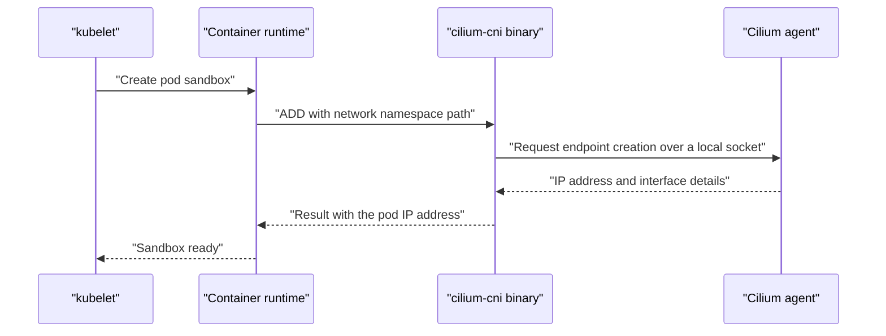

# What A CNI Plugin Does And What Cilium Adds

A pod is a group of containers that share one network namespace. A network namespace is a Linux kernel object that holds its own network interfaces, routing table and firewall rules. When Kubernetes creates a pod, the pod starts with an empty network namespace that has no interface and no address. Someone must create an interface, assign an IP address and connect the interface to the rest of the cluster. That work belongs to the network plugin, and this part explains how the plugin is called and which Cilium components take part.

## The Kubernetes network model

Kubernetes does not implement networking itself. It defines three rules and expects every cluster to satisfy them.

- Every pod gets its own IP address, and that address is unique in the cluster.
- A pod can reach every other pod by its IP address without network address translation (NAT). NAT means that a device rewrites the source or destination address of a packet.
- Agents on a node, such as the kubelet, can reach every pod on that node.

These rules say what must be true. They do not say how to make it true. A network plugin chooses the method: an overlay tunnel, plain routing, cloud routes or something else. Cilium supports several methods, and the datapath modes are explained later in the course.

## The Container Network Interface

The Container Network Interface (CNI) is a specification that describes how a container runtime calls a network plugin. The container runtime is the program that creates containers, such as containerd or CRI-O. The kubelet asks the runtime to create a pod sandbox. The runtime creates the network namespace and then calls the CNI plugin binary with an operation name and the path to that namespace.

The main operations are `ADD`, `DEL` and `CHECK`. `ADD` connects a pod to the network and returns the IP address it received. `DEL` removes the pod from the network when the pod stops. `CHECK` verifies that the pod is still connected. The runtime finds the plugin by reading a configuration file in the CNI configuration directory, normally `/etc/cni/net.d`, and it runs the binary from the CNI binary directory, normally `/opt/cni/bin`.



The `cilium-cni` binary is small. It does not decide anything itself. It forwards the request to the Cilium agent on the same node through a Unix socket, and the agent does the real work. The agent allocates an IP address, creates a virtual Ethernet (veth) pair, moves one end into the pod network namespace, and attaches kernel programs to the other end. A veth pair is two virtual network interfaces connected like the two ends of a cable: a packet that enters one end leaves at the other end.

## The Cilium components

Cilium runs as ordinary Kubernetes workloads in the `kube-system` namespace, and it adds a few custom resources.

- The Cilium agent runs as the DaemonSet `cilium`, with one pod on every node. It programs the kernel on its node, allocates pod addresses, computes policy and answers the CNI binary.
- The Cilium operator runs as the Deployment `cilium-operator`. It handles tasks that need one cluster-wide view, such as allocating address ranges to nodes and removing stale objects.
- The `cilium-cni` binary and its configuration file are copied to every node by the agent pod when it starts.
- Hubble is the observability layer. Its server is part of the agent, and an optional relay combines the data of all nodes.

Custom resources store the state that Cilium shares between components. A custom resource is an object type that an extension adds to the Kubernetes API. Examples are `CiliumNode`, `CiliumEndpoint`, `CiliumIdentity` and `CiliumNetworkPolicy`.

## Try it

First, look at the components. The next commands need no setup.

<!-- astrona:playground:renew -->

List the agent and the operator, and see on which nodes they run.

```sh
kubectl -n kube-system get daemonset cilium
kubectl -n kube-system get deployment cilium-operator
kubectl -n kube-system get pods -o wide
```

The DaemonSet shows one desired pod for each node. Next, ask one agent for its status. `cilium-dbg` is the command-line tool inside the agent container.

```sh
kubectl -n kube-system exec daemonset/cilium -c cilium-agent -- cilium-dbg status --brief
```

Last, read how Cilium stores the node and endpoint state as custom resources.

```sh
kubectl get ciliumnodes
kubectl -n starfleet get ciliumendpoints
```

Each node has one `CiliumNode`, and each pod that Cilium manages has one `CiliumEndpoint` with the same name and namespace as the pod. Pods that use the host network of the node do not get an endpoint, because they do not run in their own network namespace.

## What happens when a pod stops

The reverse path is as important as the start. When the kubelet deletes a pod, the runtime calls the plugin with `DEL`. The agent then releases the IP address back to the pool of the node, removes the endpoint and detaches its kernel programs. The `CiliumEndpoint` object disappears from the API.

If a node loses a pod without a clean `DEL`, for example after a crash, Cilium cleans up later. The agent compares the endpoints it knows with the pods the API server lists, and the operator removes `CiliumEndpoint` and `CiliumIdentity` objects that no pod uses any more. This cleanup is why stale objects can exist for a short time after a failure.

## Why the plugin needs both a binary and a daemon

A CNI plugin binary starts for each call and exits at once, so it cannot hold state between calls. Policy, identities and address pools must live in a process that runs all the time. This is why Cilium splits the work. The short-lived binary speaks the CNI protocol, and the agent, which runs as a long-lived pod, keeps the state and the kernel programs.

This split has a practical effect. When the agent restarts, the kernel programs and maps that it loaded stay in place, so traffic of running pods continues. Only new pod creation and policy changes wait until the agent is ready again.

One more point matters for the exam. The agent pod uses the host network and holds extra Linux capabilities, because it must load kernel programs and create interfaces. Applications never talk to it. They only see the interface and the address that it created.

## What to remember

The Kubernetes network model asks for unique pod addresses and NAT-free pod traffic. The CNI standard gives the container runtime a way to ask a plugin for that. Cilium answers through a small binary that forwards to the agent, while the operator and the custom resources handle the cluster-wide view. The next question is how the agent forwards packets and enforces rules at high speed, and the answer is a kernel feature called eBPF.

## Common pitfalls

> [!WARNING]
> A pod stays in `ContainerCreating` when the CNI call fails. Check the events of the pod and the logs of the Cilium agent on that node before you change anything else. Also remember that the Cilium agent pod is itself a workload: when it is not ready on a node, new pods on that node cannot get an address.
