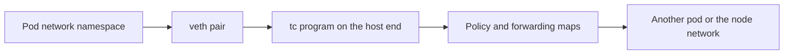

# eBPF And The Cilium Datapath

A packet that travels between two pods passes through the Linux network stack. The network stack is the part of the kernel that receives packets from network cards, decides what to do with them and delivers them to programs. Classic Kubernetes networking changes the behaviour of that stack with iptables rules. Cilium changes it by loading small programs into the kernel instead. This part explains what those programs are, where they attach and why Cilium prefers them.

## What eBPF is

eBPF (extended Berkeley Packet Filter) is a Linux kernel feature that runs small, verified programs inside the kernel. A user-space tool compiles a program, loads it into the kernel, and attaches it to a hook. A hook is a point in the kernel where the program runs when an event happens, for example when a packet arrives on a network interface or when a process opens a connection.

Before the kernel accepts a program, a verifier checks it. The verifier proves that the program ends, does not read outside its memory and calls only allowed helper functions. A program that fails the check is rejected. This check is why eBPF code can run in the kernel without the risks of a kernel module.

Programs keep state in maps. A map is a key-value store in kernel memory that programs and user-space tools can both read and write. Cilium keeps data such as the table that maps IP addresses to identities, the table of tracked connections and the policy rules of every endpoint in maps.

## Why Cilium uses eBPF

An iptables rule set is a list. The kernel checks a packet against the rules one after the other, so a cluster with many Services or policies has long lists and the cost grows with the length. When a rule changes, the tool often rewrites a whole table.

An eBPF map is a hash table. A lookup takes about the same time for ten entries and for ten thousand. Cilium changes one map entry when one pod or one policy changes, and it does not rewrite a table. eBPF programs also attach early, close to the network interface, so a packet that policy denies is dropped before it travels further through the stack.

## Where the programs attach

The agent attaches programs at several hooks. The most important ones are these.

- The traffic control (tc) hook on the host side of each pod veth interface. Programs here see every packet that enters or leaves a pod. They apply policy and forward the packet.
- The tc hook on the network device of the node and on the tunnel device when an overlay is in use. Programs here handle traffic that enters from the node network.
- Socket hooks on the control group of the node. They run when a program calls `connect` and can translate a Service address to a pod address before any packet exists.



## Try it

Look at the kernel objects that Cilium created on a node.

<!-- astrona:playground:renew -->

Run a shell command inside the agent pod to list the network interfaces of the node it manages. The agent pod uses the host network, so it sees the interfaces of the node.

```sh
kubectl -n kube-system exec daemonset/cilium -c cilium-agent -- ip link show
```

Look for interfaces whose names start with `lxc`. Each one is the host end of a pod veth pair. Look also for `cilium_host` and `cilium_net`, a veth pair that Cilium creates for traffic between the node and its pods.

Now read what the agent keeps in maps. The first command lists the endpoints with their identities, and the second lists the Service translation table.

```sh
kubectl -n kube-system exec daemonset/cilium -c cilium-agent -- cilium-dbg endpoint list
kubectl -n kube-system exec daemonset/cilium -c cilium-agent -- cilium-dbg bpf lb list
```

The endpoint list has one row per pod on that node and shows the policy state and the numeric identity. The load-balancer list shows the Service addresses that the kernel can translate without iptables.

## Identity in the datapath

Cilium does not match policy by IP address, because pod addresses change when pods restart. It gives each set of pod labels a numeric security identity and matches policy by that number. The identity of the remote side is found in two ways. On the same node or in native routing mode, the program looks up the source address in a map that links IP addresses to identities. In overlay mode, the sending node can write the identity into the tunnel header, so the receiving node reads it directly.

Policy is a second set of maps. Each endpoint has a policy map whose keys are an identity, a port and a protocol. When a packet arrives, the program finds the remote identity, looks up the key in the policy map of the endpoint, and forwards or drops the packet. That is the whole decision, and no IP address list is involved.

## Following one request

A short example shows how the pieces fit. The pod `shuttle` calls the Service `probe` by its cluster IP address. The Service address does not belong to any interface, so no packet can reach it directly.

With the socket hook, the program that runs at `connect` replaces the Service address with the address of one backend pod before the first packet leaves. The packet then carries the address of a real pod from the start. Without the hook, a program at the pod interface has to rewrite the destination of every packet and the replies, and it records each translation in a connection tracking map.

The tc program on the host end of the `shuttle` veth pair then looks up the destination. If the backend runs on the same node, the program forwards the packet straight to the veth interface of that pod. If it runs on another node, the program hands the packet to the routing or tunnel path that the datapath mode selects.

At the receiving side, the program on the veth interface of the backend pod checks the policy map for the identity of `shuttle`. A match lets the packet pass, and no match drops it. The result is the same path with fewer steps than a chain of iptables tables.

## Limits to keep in mind

eBPF programs have a size limit and run for a bounded time, so complex logic is split into several programs. Cilium also uses a user-space proxy for features that need to read application protocols, such as HTTP rules. The kernel programs redirect only the traffic that matches such a rule to the proxy.

The agent is the single writer of these maps on its node. Do not edit maps by hand on a production node, because the agent overwrites inconsistent entries and a manual change can disrupt traffic.

## What to remember

eBPF programs run in the kernel after a verifier accepts them, they keep state in hash-table maps, and they attach to hooks near the network interface and the socket. Cilium uses them to forward packets, to translate Services and to enforce identity-based policy without long iptables lists. The agent loads and updates these programs and maps on each node.

## Common pitfalls

> [!WARNING]
> eBPF features depend on the kernel version of the node. A feature that works on one node image can be missing on an older kernel, and the agent reports it in its status output. Do not assume that a documented feature works on every node until the agent confirms it.
