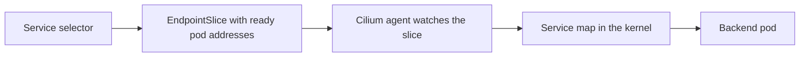

# The Path Of Pod And Service Traffic

Most applications do not call a pod by its address. They call a Service by name. The name resolves to a cluster IP, and the cluster IP does not belong to any pod or interface. Something must connect that virtual address to a real pod. This part explains who makes that connection, which objects hold the result, and how a wrong selector breaks it silently.

## From selector to endpoints

A Service has a selector, which is a set of labels. The Kubernetes control plane watches the pods in the namespace of the Service and collects the addresses of the pods that match the selector and are ready. It stores them in EndpointSlice objects. An EndpointSlice is an API object that lists backend addresses and ports for one Service.

If the selector matches no pod, the EndpointSlice is empty and the Service has no backends. The Service object still exists and its cluster IP still resolves, but a request to it cannot connect. This is a common fault, and no network plugin can repair it, because the plugin only translates what the EndpointSlices say.



## How Cilium translates a Service address

The Cilium agent watches Services and EndpointSlices through the API server. For each Service it writes entries into a kernel map that links a frontend, the cluster IP and port, to a list of backends, the pod IP addresses and ports. When Cilium replaces the standard Service proxy, a hook on the socket of the client rewrites the destination at `connect` time. The first packet therefore already goes to the chosen backend.

The standard Service proxy is `kube-proxy`. It runs on every node and programs iptables or IPVS rules for the same purpose. Cilium can take over this task, which is called kube-proxy replacement. Both approaches produce the same result for the application: one Service address, several backends and one chosen per connection. They differ in where the rules live and how they scale.

Cilium chooses a backend per connection, not per packet. A connection stays on its backend until it closes, which keeps TCP sessions intact. A tracking map remembers the choice for traffic that does not use the socket hook.

## Reading the objects

Each step has an object that shows its state. Reading them in order finds the failing step.

- The Service shows the selector and the cluster IP.
- The EndpointSlices show which pod addresses the control plane selected.
- The pods show their labels and readiness.
- The `CiliumEndpoint` of each pod shows how Cilium sees it and which identity it has.
- The agent shows the translated Service entries in its kernel map.

A fault that appears early in this list leaves every later step empty. For that reason, always start at the Service and work toward the agent.

## Try it

Read the chain for the Service `probe`.

<!-- astrona:playground:renew -->

Start with the selector and the endpoints that it produced.

```sh
kubectl -n starfleet get service probe -o jsonpath='{.spec.selector}{"\n"}'
kubectl -n starfleet get endpointslices -l kubernetes.io/service-name=probe
kubectl -n starfleet get pods --show-labels
```

The selector labels must be a subset of the pod labels. The EndpointSlice must list the addresses of the two ready `probe` pods. Now ask the agent how it translated the Service.

```sh
kubectl -n kube-system exec daemonset/cilium -c cilium-agent -- cilium-dbg service list
```

Find the row whose frontend is the cluster IP of `probe` and compare its backends with the pod addresses from `kubectl get pods -o wide`. Finally, send a request from the client pod.

```sh
kubectl -n starfleet exec shuttle -- curl -s -m 5 -o /dev/null -w '%{http_code}\n' http://probe.starfleet:9898/healthz
```

A response code of 200 means that selection, translation and delivery all worked.

## Break it and read the fault

Change the selector to a label that no pod has and read the chain again. The patch below sets a selector that matches nothing.

```sh
kubectl -n starfleet patch service probe --type merge -p '{"spec":{"selector":{"app":"nothing"}}}'
kubectl -n starfleet get endpointslices -l kubernetes.io/service-name=probe
```

The EndpointSlice now has no addresses, and the request from `shuttle` fails even though every pod is healthy. Restore the original selector with `{"spec":{"selector":{"app":"probe"}}}` in the same patch command.

## What to remember

A request needs three things in order: a Service that selects pods, a datapath that carries the packet, and policy that allows it. The Service layer ends at the EndpointSlice. Cilium turns the EndpointSlice into kernel map entries and then chooses a backend per connection. When a Service has no backends, look at the selector first, because the network plugin cannot fix it.

## Common pitfalls

> [!WARNING]
> A Service with an empty EndpointSlice and a Service blocked by policy can look the same from the client, because both time out or are refused. Read the EndpointSlice first. Only when it lists healthy pod addresses should you look at policy.
