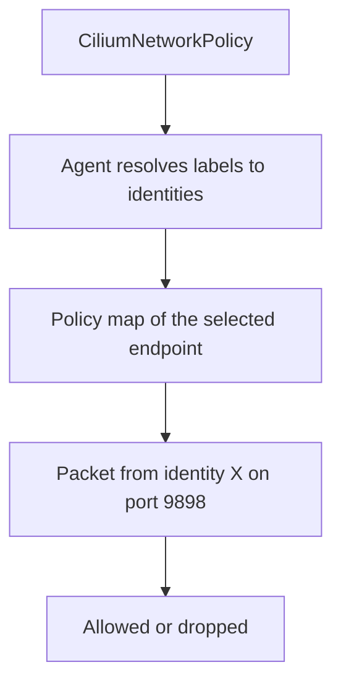

# Policy And Identity-Based Rules

After a Service has chosen a backend and the datapath has carried the packet, one question remains: is this traffic allowed? Kubernetes answers it with the NetworkPolicy object, and Cilium answers it with its own object, CiliumNetworkPolicy, in addition to NetworkPolicy. This part explains how Cilium policy selects workloads, what an allow rule means, and how identities replace address lists.

## Default allow and default deny

A cluster without policy allows all traffic between pods. A policy changes this only for the pods it selects. A pod that no policy selects stays fully open. A pod that an ingress policy selects accepts only the ingress traffic that some rule allows, and it still sends all egress traffic. Egress works the same way in the other direction.

Policy is additive. It contains only allow rules, and the allowed set is the union of all rules that select the pod. There is no deny rule in standard NetworkPolicy, so you remove access by not allowing it. CiliumNetworkPolicy also supports explicit deny rules, but this part keeps to the allow model.

## How Cilium matches who may connect

A rule names the peer by labels, not by address. The agent converts the labels to the numeric security identities that currently have those labels and writes them into the policy map of every endpoint that the policy selects. When a pod is created or deleted, the identity set changes, and the agent updates the map. No one edits an address list.

The namespace of a pod is also a label. Cilium adds the label `k8s:io.kubernetes.pod.namespace` to every identity, so a rule can select all pods of one namespace with that label.



## A policy that allows one port from one namespace

The policy below selects the pods with the label `app: probe` in `starfleet`. It allows TCP port 9898 only from pods in the `outpost` namespace. Because it selects `probe` for ingress, every other source is denied.

Save this as `probe-from-outpost.yaml`.

```yaml
apiVersion: cilium.io/v2
kind: CiliumNetworkPolicy
metadata:
  name: probe-from-outpost
  namespace: starfleet
spec:
  endpointSelector:
    matchLabels:
      app: probe
  ingress:
  - fromEndpoints:
    - matchLabels:
        k8s:io.kubernetes.pod.namespace: outpost
    toPorts:
    - ports:
      - port: "9898"
        protocol: TCP
```

## Try it

Apply the policy and test the three clients.

<!-- astrona:playground:renew -->

Apply it.

```sh
kubectl apply -f probe-from-outpost.yaml
```

Check that Cilium accepted it and that it selected both `probe` pods.

```sh
kubectl -n starfleet get ciliumnetworkpolicies
kubectl -n starfleet get ciliumendpoints
```

Now test both clients. The request from `drifter` should succeed, and the request from `shuttle` should time out, because `shuttle` is in `starfleet` and the rule allows only `outpost`.

```sh
kubectl -n outpost exec drifter -- curl -s -m 5 -o /dev/null -w '%{http_code}\n' http://probe.starfleet:9898/healthz
kubectl -n starfleet exec shuttle -- curl -s -m 5 -o /dev/null -w '%{http_code}\n' http://probe.starfleet:9898/healthz
```

A timeout prints `000` with this `curl` format, because no HTTP response arrives. Delete the policy when you finish, and the old open behaviour returns.

```sh
kubectl -n starfleet delete ciliumnetworkpolicy probe-from-outpost
```

## CiliumNetworkPolicy and NetworkPolicy

Both objects work with Cilium. NetworkPolicy is the standard Kubernetes object, and every compatible plugin supports it. CiliumNetworkPolicy adds fields that the standard object lacks, such as DNS-name rules, HTTP method and path rules, explicit deny rules and entities such as `world` and `host`. Cilium translates both objects into the same internal rules, so a cluster can use them together.

Use the standard object when portability matters, and use the Cilium object when you need these extra fields. Do not write two objects that describe the same rule, because the allowed set is the union of all policies and a duplicate only makes later audits harder.

## What to remember

Cilium policy selects endpoints by labels and allows peers by labels. The agent resolves labels to security identities and stores them in the policy map of each selected endpoint. Selecting a pod makes that direction default-deny for that pod, and rules add exceptions. The namespace is a label like any other, which makes namespace-based rules simple.

## Common pitfalls

> [!WARNING]
> A policy that selects a pod for ingress also blocks traffic you did not think about, such as monitoring probes from another namespace. After you apply a policy, test every legitimate client, not only the one you wrote the policy for.
