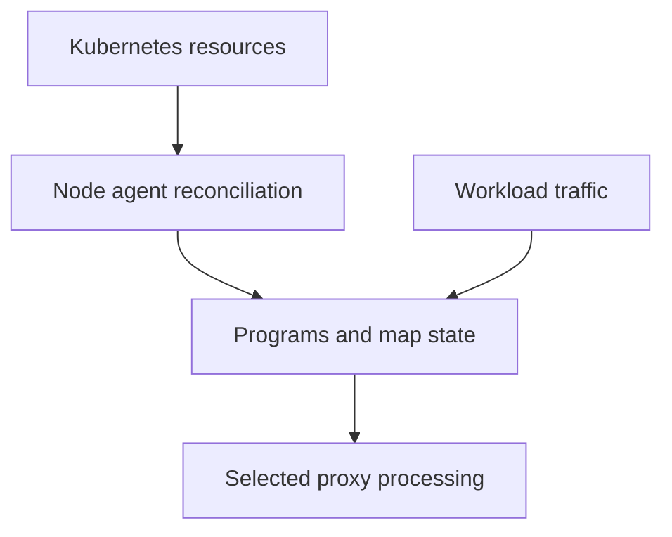

# Desired Networking State And The Programmed Datapath

Cilium architecture separates state discovery and reconciliation from the mechanisms that handle packets. Kubernetes resources describe workloads, Services and policies. Cilium components interpret those resources and program local state. The datapath then forwards, translates or filters traffic using that state at supported execution points.

## Desired State Reaches The Agent

The node agent watches relevant orchestration state and manages endpoints on its node. A Pod lifecycle, changed Service backend or policy update can require new local configuration. The agent translates those changes into the structures used by its datapath. A resource accepted by the Kubernetes API is therefore an input to reconciliation rather than proof that every node has applied it.

This distinction is useful when behavior differs across nodes. One agent may have converged while another has a stale view or a local failure. Compare the intended resource, observed agent state and affected endpoint. A single successful connection from one node does not establish universal convergence.

## Programs And Maps Serve Different Roles

eBPF programs run at supported kernel hooks and perform bounded processing such as forwarding, service handling or policy decisions. Maps store state that programs can consult, including relevant connection, identity or backend information. Programs define behavior, while map entries supply changing inputs to that behavior.

Updates to a Service can change backend state without requiring every packet to consult the Kubernetes API. That reduces dependence on an API request for each connection, but correctness still depends on the programmed state matching the intended current topology. A valid program with stale backend data can perform the wrong current operation.

## Layer 7 Can Involve A Proxy

Application-aware features may redirect selected traffic to Envoy or another supported proxy path. HTTP routing and policy need protocol context that differs from simple address and port filtering. Calling the overall implementation eBPF-based does not mean every feature executes entirely inside an eBPF program.

The proxy has configuration, listener and availability requirements of its own. A correctly routed packet can reach a proxy whose route does not match the request host or path. Conversely, a valid proxy route can point to an unavailable backend. Keep packet transport and application-layer handling separate when explaining a failure.

## Cluster-Wide Responsibilities Remain Separate

The operator handles responsibilities that should be coordinated at cluster scope, including selected IPAM operations and cleanup. Its role depends on the configured mode. It is not normally in the critical path of every forwarded packet. A temporary operator outage can leave established forwarding intact while delaying work that needs new allocation or reconciliation.

Hubble observes supported datapath events and exposes them through its own API and aggregation components. It helps explain behavior but does not replace the agent or act as the application's forwarding path. An observability outage can therefore coexist with functioning traffic.

## Interpret Partial Failure

Suppose old Pods communicate but new Pods cannot obtain addresses. Investigate allocation and endpoint preparation rather than conclude the entire datapath is healthy or broken. If only HTTP policy traffic fails, investigate the selected proxy path as well as endpoint policy. Kernel support, enabled configuration and component versions constrain the available implementation. Review the stage that owns the failed transition and the evidence it can provide.

## State And Traffic Paths

The state path supplies decisions to the traffic path. Selected application processing can involve a proxy; neither arrow implies that every packet invokes the Kubernetes API.

## Common pitfalls

> [!WARNING]
> API acceptance is not datapath convergence. Existing traffic can survive some control-component outages, and eBPF-based networking can still depend on proxies for selected Layer 7 behavior.
