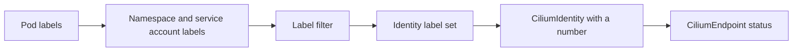

# Labels Become Security Identities

An IP address says where a pod is now. It says nothing about what the pod is. Cilium needs a stable description of what a workload is, so that policy still applies after the pod moves to another node and receives another address. This part explains how Cilium builds that description from labels and gives it a number.

## The identity of a workload

A security identity is a number that Cilium assigns to a set of labels. All pods whose relevant labels are exactly equal share one identity, no matter how many pods there are, on which nodes they run or what addresses they have. The two `probe` pods in the playground therefore have the same identity.

Cilium builds the label set from several sources. It adds the labels of the pod, the labels of the namespace, and the service account name. It prefixes each label with its source, such as `k8s:` for labels that come from Kubernetes. The namespace appears as the label `k8s:io.kubernetes.pod.namespace`.

Not every label is part of the identity. Labels that change often or carry no meaning for security, such as the `pod-template-hash` label that Deployments add, would create a new identity for each rollout. Cilium filters such labels out. The rule is a list of patterns for labels that count, and the agent applies it when it builds the label set.

## Reserved identities

Some identities have fixed numbers and fixed meanings. They are called reserved identities, and their numbers are small.

- `host` is the local node, with the number 1.
- `world` is any address outside the cluster, with the number 2.
- `unmanaged` is a pod that Cilium does not manage, with the number 3.
- `health` is the health-check endpoint of Cilium, with the number 4.
- `init` is an endpoint that has no identity yet, with the number 5.
- `remote-node` is another node of the cluster, with the number 6.
- `kube-apiserver` is the Kubernetes API server, with the number 7.

Identities that Cilium allocates for workloads start above the reserved range. A policy can refer to the reserved ones by name, which are called entities in a CiliumNetworkPolicy.

## Where identities are stored

By default Cilium stores identities in the Kubernetes API as `CiliumIdentity` objects. The name of the object is the number. The object lists the labels that the number stands for. When the agent needs an identity for a new label set, it looks up an existing object or creates a new one, and all agents share the result. An alternative is an external key-value store, but the default needs no extra component.



## Try it

Look at the identities in the playground.

<!-- astrona:playground:renew -->

List the identity objects and the identity of each endpoint.

```sh
kubectl get ciliumidentities
kubectl -n starfleet get ciliumendpoints -o custom-columns=NAME:.metadata.name,IDENTITY:.status.identity.id
kubectl -n outpost get ciliumendpoints -o custom-columns=NAME:.metadata.name,IDENTITY:.status.identity.id
```

The two `probe` pods show the same number. Pick one number and read the labels that stand behind it.

```sh
kubectl get ciliumidentity <number> -o jsonpath='{.security-labels}{"\n"}'
```

Replace `<number>` with the identity of `probe`. The result lists the labels, including the namespace label and the application label. Now change a label on a running pod and check what happens to its identity.

```sh
kubectl -n starfleet label pod shuttle crew=bridge
kubectl -n starfleet get ciliumendpoint shuttle -o jsonpath='{.status.identity.id}{"\n"}'
```

The identity of `shuttle` changes after the label is added, because the label set changed. The same label added to a Deployment template would change the identity of every pod after the rollout. Remove the label with `kubectl -n starfleet label pod shuttle crew-` when you finish.

## Identities across nodes and namespaces

Two pods in different namespaces never share an identity, even when their own labels are equal, because the namespace label is part of the set. The `shuttle` pod in `starfleet` and the `drifter` pod in `outpost` therefore have different identities, and a rule can allow one and deny the other.

Two pods on different nodes do share an identity when their label sets are equal. Every agent knows the number, because the `CiliumIdentity` object is stored in the shared API. This is why a rule written once applies on every node.

Cilium also creates identities for traffic that comes from outside the cluster. A source address that matches no known pod or node is the reserved identity `world`. A policy can allow or deny that identity as an entity, which is how a rule restricts access from the internet.

## Why this matters for access

A policy rule such as "allow pods with the label `role: client`" is evaluated against identities. If a pod lacks the label, it has a different identity from the clients, and the rule does not allow it. Adding the label gives the pod a new identity that the rule matches. The fix therefore lies in the labels of the pod and not in the policy.

The reverse also holds. If someone removes a label from a pod, it loses the access that depended on that label, which is a way to cut a workload off without touching any policy.

## What to remember

Cilium turns the relevant labels of a pod, its namespace and its service account into a label set and gives each distinct set one number. Pods with equal sets share the number. Reserved numbers cover the host, the outside world and other special peers. The identities live in `CiliumIdentity` objects, and each endpoint reports its number in its status. A change of the label set changes the identity and therefore the access.

## Common pitfalls

> [!WARNING]
> Labels are security input. Anyone who can edit the labels of a pod can change which policy applies to it. Restrict permission to patch pods and Deployments accordingly, and do not select peers by labels that applications set for themselves.
