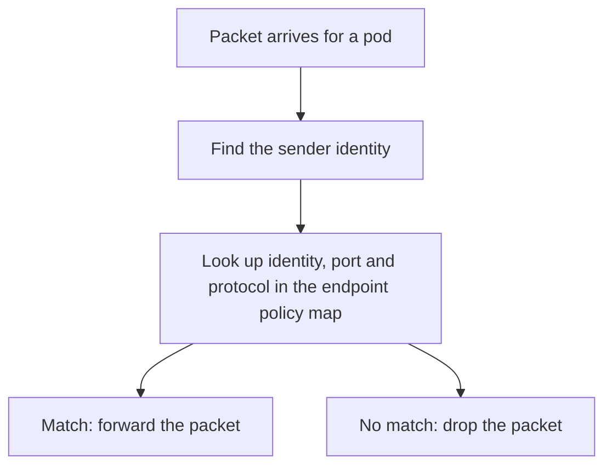

# Identity In The Datapath

An identity helps only if the kernel can read it at the moment a packet arrives. This part follows the identity from the API objects into the kernel programs and shows where the decision to allow or drop a packet is made. It also explains the difference between the policy you wrote and the policy that the agent has realised.

## Desired state and realised state

Policy has two forms. The desired state is what you wrote: CiliumNetworkPolicy and NetworkPolicy objects. The realised state is what the agent has loaded into the kernel for each endpoint after it resolved labels to identities. The two can differ for a short time after a change, and they can differ for a long time if the agent cannot apply a change.

The agent turns desired state into realised state in steps.

- It watches policy objects and pods through the API server.
- It builds a selector cache that links each label selector to the set of identities that match now.
- For each endpoint that a policy selects, it computes the allowed combinations of remote identity, port and protocol.
- It writes these combinations into the policy map of the endpoint and regenerates the endpoint programs when needed.

When a new pod appears with a matching label, only the selector cache and the maps change. The policy objects stay the same.

## Knowing the sender

The program that decides on a packet must know the sender identity. How it learns it depends on where the packet comes from.

- For traffic from a pod on the same node, the program knows the identity of the local endpoint.
- For traffic from a remote pod in native routing mode, the program looks up the source IP address in an IP cache map that links addresses to identities. The agent fills this map from the pods and nodes it watches.
- For traffic that arrives through an overlay tunnel, the sending node can put the identity into the tunnel header, and the receiving node reads it directly.



The destination endpoint applies ingress policy, and the source endpoint applies egress policy. A connection is allowed only if both directions that have a policy permit it. Replies of an allowed connection pass automatically, because connection tracking recognises them.

## A label-based rule in action

The policy below allows only pods with the label `crew: member` to reach `probe` on port 9898. A rule that selects by a label that you control is a good way to see the identity change.

Save this as `probe-from-crew.yaml`.

```yaml
apiVersion: cilium.io/v2
kind: CiliumNetworkPolicy
metadata:
  name: probe-from-crew
  namespace: starfleet
spec:
  endpointSelector:
    matchLabels:
      app: probe
  ingress:
  - fromEndpoints:
    - matchLabels:
        crew: member
    toPorts:
    - ports:
      - port: "9898"
        protocol: TCP
```

## Try it

Apply the policy and watch the effect of a label.

<!-- astrona:playground:renew -->

Apply it, and test from `shuttle`, which has no `crew` label yet.

```sh
kubectl apply -f probe-from-crew.yaml
kubectl -n starfleet exec shuttle -- curl -s -m 5 -o /dev/null -w '%{http_code}\n' http://probe.starfleet:9898/healthz
```

The request times out. Read the identity of `shuttle`, then add the label and read it again.

```sh
kubectl -n starfleet get ciliumendpoint shuttle -o jsonpath='{.status.identity.id}{"\n"}'
kubectl -n starfleet label pod shuttle crew=member
kubectl -n starfleet get ciliumendpoint shuttle -o jsonpath='{.status.identity.id}{"\n"}'
```

The number changed. Test the request again after a few seconds and it now succeeds. Last, ask an agent for the realised policy of the `probe` endpoint. First find the endpoint number with `cilium-dbg endpoint list` on the node that runs `probe`, then read its policy map.

```sh
kubectl -n kube-system exec daemonset/cilium -c cilium-agent -- cilium-dbg endpoint list
kubectl -n kube-system exec daemonset/cilium -c cilium-agent -- cilium-dbg bpf policy get <endpoint-id>
```

The map lists the identities that may connect, with the port and protocol. Delete the policy and remove the label when you finish.

## Why a new identity needs a moment

When the label changes, the agent must allocate or look up the new identity, update the endpoint, and regenerate its programs. The IP cache entry of the pod then points to the new number on every node. During this short time, a request can still be judged with the old identity. Tests that run right after a label change should retry for a few seconds before they conclude that policy is wrong.

## What to remember

The policy you write is desired state. The agent resolves selectors to identities and writes the result into per-endpoint policy maps, which is the realised state. The datapath finds the sender identity from the local endpoint, from an IP cache or from the tunnel header, and then looks it up in the policy map. A label change causes a new identity and a short delay until every node has the new mapping.

## Common pitfalls

> [!WARNING]
> Do not read only the policy object when you debug a denied request. Compare it with the identity that the endpoint really has. A correct policy and a wrong label produce exactly the same symptom as a wrong policy.
