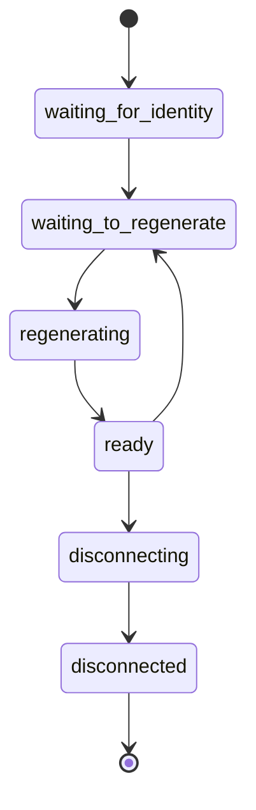

# Endpoints And Their Lifecycle

The agent needs one handle for everything that belongs to a pod on a node: its interface, its address, its identity and its loaded programs. That handle is the endpoint. This part explains what an endpoint contains, how it is numbered, how it appears in the Kubernetes API and which states it passes through.

## What an endpoint is

An endpoint is the agent's record of one network-attached workload on one node. It holds the host-side interface, the IP addresses, the security identity, the labels, the policy state and the identifiers of the programs that are attached to it. Each endpoint has an endpoint ID, a number that is unique only on its node. The same pod would have a different number if it ran on another node.

Do not confuse the endpoint ID with the identity. The endpoint ID names one pod instance on one node. The identity names a set of labels and is shared by every pod with those labels in the whole cluster. The endpoint ID changes when a pod is recreated. The identity stays the same as long as the labels do.

## The CiliumEndpoint object

The agent publishes each endpoint as a `CiliumEndpoint` custom resource. It has the same name and namespace as the pod. The fields that matter most are in the status.

- `status.id` is the endpoint ID on its node.
- `status.identity.id` is the numeric security identity, and `status.identity.labels` lists the labels behind it.
- `status.state` is the lifecycle state of the endpoint.
- `status.networking.addressing` lists the IP addresses.
- `status.networking.node` is the IP address of the node that runs the pod.

Other nodes read `CiliumEndpoint` objects to learn which address belongs to which identity. The agent of the node that owns the pod is the only writer.

## Endpoint states

An endpoint moves through states as the agent prepares it.

- `waiting-for-identity` means that the agent still resolves the identity.
- `waiting-to-regenerate` means that the endpoint needs new programs and waits in a queue.
- `regenerating` means that the agent builds and loads the programs.
- `ready` means that programs and policy are in place and traffic is handled.
- `not-ready`, `disconnecting` and `disconnected` mark a failed or finished endpoint.
- `restoring` appears after an agent restart, while the agent reconnects to the endpoints that already existed.



## What causes a regeneration

Regeneration rebuilds and reloads the programs of an endpoint. It runs when something that the programs depend on changes. The common causes are a policy change that selects the endpoint, a change of the identity, a change of agent configuration and the arrival of a new peer identity in a rule that uses selectors. Most changes only update maps and need no rebuild, which keeps the effect small.

An endpoint in `ready` state handles traffic with the previous programs while it waits for the next regeneration, so a regeneration does not interrupt connections.

## Try it

Read the objects for the pod `probe`.

<!-- astrona:playground:renew -->

List the endpoints with their IDs, identities and states.

```sh
kubectl -n starfleet get ciliumendpoints -o custom-columns=NAME:.metadata.name,ID:.status.id,IDENTITY:.status.identity.id,STATE:.status.state
```

Read the full object of one endpoint.

```sh
kubectl -n starfleet get ciliumendpoint shuttle -o yaml
```

Find `status.networking.addressing` and compare the address with the output of `kubectl -n starfleet get pod shuttle -o wide`. Now ask the agent on the node of `shuttle` for its own list. Use `-o wide` first to find the node, then pick the agent pod on that node.

```sh
kubectl -n kube-system get pods -l k8s-app=cilium -o wide
kubectl -n kube-system exec <agent-pod> -c cilium-agent -- cilium-dbg endpoint list
```

The agent list shows the same endpoint ID as the `CiliumEndpoint`, together with the policy enforcement state for ingress and egress. The list also contains an endpoint for the host and one for the health check, which have no pod.

## Endpoint IDs after a restart

Delete one `probe` pod and let its Deployment create a replacement.

```sh
kubectl -n starfleet delete pod -l app=probe --field-selector spec.nodeName=<node-name>
kubectl -n starfleet get ciliumendpoints -o custom-columns=NAME:.metadata.name,ID:.status.id,IDENTITY:.status.identity.id
```

Replace `<node-name>` with the name of one node that runs a `probe` pod. The replacement pod has a new name, a new address and usually a new endpoint ID. The identity is the same as before, because the labels did not change. This difference between the two numbers is the reason why policy is written against identities.

## What to remember

An endpoint is the agent's record of one pod on one node. The CiliumEndpoint object publishes its ID, identity, state and addresses. The endpoint ID is local to a node, and the identity is shared by every pod with the same labels. Endpoints move from waiting states through regeneration to `ready`, and they regenerate when something the programs depend on changes.

## Common pitfalls

> [!WARNING]
> Do not store an endpoint ID in a script or a policy. It is unique only per node, it changes when the pod is recreated, and it means a different pod on a different node. Use the identity or the labels instead.
