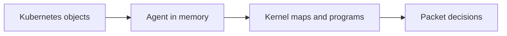

# Desired And Realised State

When a request is denied or a pod cannot be reached, the objects in the API tell only part of the story. They describe what the cluster should look like. The kernel on each node holds what is really in effect. This part shows how to compare the two with the agent tool, and how to find the packets that the datapath dropped.

## The agent tool

The Cilium agent image includes a command-line tool called `cilium-dbg`. It talks to the agent on the same node, so it must run inside the agent pod. It shows the agent's own state and the contents of the kernel maps. The commands are read-only for the uses in this part.

Because each agent knows only its node, the right pod matters. For a question about a pod, run the command in the agent pod on the node of that pod. `kubectl get pods -o wide` shows the node of each pod.

## Commands that show realised state

The following commands cover most investigations.

- `cilium-dbg status` summarises the health of the agent, including the datapath mode and the address allocation.
- `cilium-dbg endpoint list` lists the endpoints with ID, identity, policy state and addresses.
- `cilium-dbg endpoint get <id>` prints the full record of one endpoint.
- `cilium-dbg identity list` lists the identities that this agent knows with their labels.
- `cilium-dbg bpf endpoint list` lists the IP addresses that belong to local endpoints in the kernel map.
- `cilium-dbg bpf ipcache list` lists the IP address to identity map that the datapath uses for remote peers.
- `cilium-dbg bpf policy get <id>` lists the allowed identity, port and protocol entries of one endpoint.

Each command reads a different layer, which makes the comparison useful. If the `CiliumEndpoint` says identity 9000 and the IP cache says another number for the same address, the realised state is behind the desired state.



## Finding dropped traffic

A denied packet leaves no log by default. The monitor command prints events from the datapath, including drops, and shows the reason. `cilium-dbg monitor --type drop` prints only dropped packets. A policy denial shows the reason "Policy denied" in the event, together with the source and destination identity. With these two numbers you can tell which identity pair needs a rule.

The monitor shows one node at a time and it prints events while it runs, so you start it first and then send the request that you want to see.

## Try it

Make the datapath drop a request and read the reason.

<!-- astrona:playground:renew -->

First select `probe` with a policy that allows only a label that no pod has. Save this as `probe-allow-nobody.yaml`.

```yaml
apiVersion: cilium.io/v2
kind: CiliumNetworkPolicy
metadata:
  name: probe-allow-nobody
  namespace: starfleet
spec:
  endpointSelector:
    matchLabels:
      app: probe
  ingress:
  - fromEndpoints:
    - matchLabels:
        crew: nobody
```

Apply it.

```sh
kubectl apply -f probe-allow-nobody.yaml
```

Find the agent pod on the node that runs a `probe` pod, and start the monitor in a second terminal. Use `kubectl -n starfleet get pods -o wide` and `kubectl -n kube-system get pods -l k8s-app=cilium -o wide` to match the node.

```sh
kubectl -n kube-system exec <agent-pod> -c cilium-agent -- cilium-dbg monitor --type drop
```

Send a request from `shuttle` in the first terminal.

```sh
kubectl -n starfleet exec shuttle -- curl -s -m 5 -o /dev/null -w '%{http_code}\n' http://probe.starfleet:9898/healthz
```

The monitor prints a drop event with the reason and the two identity numbers if the chosen `probe` pod runs on the monitored node. If you see no event, the request went to the `probe` pod on the other node, so run the monitor in the other agent pod. Compare the source number with the identity of `shuttle` from its `CiliumEndpoint`.

Now read the policy map of the `probe` endpoint on the same node, and notice that it has no entry for the identity of `shuttle`.

```sh
kubectl -n kube-system exec <agent-pod> -c cilium-agent -- cilium-dbg bpf policy get <endpoint-id>
```

Delete the policy when you finish with `kubectl -n starfleet delete ciliumnetworkpolicy probe-allow-nobody`.

## Reading the layers in order

A denied request has three common causes: the sender has the wrong identity, the policy lacks a rule for the right identity, or the realised state lags behind. The monitor event gives the identity pair. The `CiliumEndpoint` and the identity list confirm that the sender really has that identity. The policy map shows whether a rule exists in the kernel. Going through these three in order finds the cause without guessing.

## What to remember

The Kubernetes objects are the desired state, and the agent and the kernel maps hold the realised state. `cilium-dbg` runs in the agent pod of the right node and reads the agent view, the endpoint records, the identity list, the IP cache and the policy maps. The monitor shows dropped packets with the reason and the identity pair, which turns a silent timeout into a concrete finding.

## Common pitfalls

> [!WARNING]
> `cilium-dbg` shows one node only. If you query the agent on the wrong node, the endpoint is simply missing from the list, which can be mistaken for a fault. Always match the agent pod to the node of the pod you investigate.
