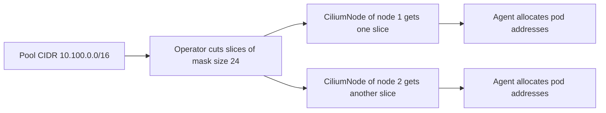

# Cluster Pool Mode

A pod address must be unique in the cluster, and the routing between nodes must know which node owns which addresses. The simplest way to guarantee both is to give each node its own range and let the node hand out addresses only from that range. This part explains how the cluster-pool mode does this and which settings control it.

## Why each node owns a range

If every agent picked addresses from one shared list, the agents would have to coordinate on every pod start, which is slow and fragile. A range per node removes that need. The agent on a node allocates from its range without asking anyone, because no other node uses these addresses.

A range per node also helps routing. Other nodes need only one route per node, "this range lives on that node", and not one route per pod. The number of routes grows with the number of nodes and not with the number of pods.

## How cluster pool works

In cluster-pool mode, the Cilium operator owns the address ranges. The operator reads a list of pool CIDRs and a mask size from the configuration. It cuts each pool CIDR into slices of that mask size and gives one free slice to each node.

The result of the allocation is written to the `CiliumNode` object of the node, in `spec.ipam.podCIDRs`. The agent on the node watches its own `CiliumNode` and starts to allocate pod addresses from that slice. When a node is removed, the operator returns its slice to the pool.



## The settings

Three settings define the behaviour, and the agent and the operator read them from the ConfigMap `cilium-config` in `kube-system`.

- `ipam` holds the mode. The value for this mode is `cluster-pool`.
- `cluster-pool-ipv4-cidr` holds the list of pool CIDRs for IPv4 pods.
- `cluster-pool-ipv4-mask-size` holds the size of each node slice as a prefix length, such as `24`.

The Helm chart sets them from the values `ipam.mode`, `ipam.operator.clusterPoolIPv4PodCIDRList` and `ipam.operator.clusterPoolIPv4MaskSize`. The mask size must be larger than the prefix length of the pool, because a slice must fit inside the pool.

## Sizing the pool

Two numbers limit a cluster. The first is the number of nodes that the pool can serve. A `/16` pool cut into `/24` slices gives 2 to the power of 8, which is 256 slices, so 256 nodes. The second is the number of pods per node. A `/24` slice has 256 addresses, and the agent reserves some of them for itself, so a node can run fewer than 256 pods.

You can trade one number against the other. A `/16` pool with `/25` slices serves 512 nodes with about half the pods each. If the pool is too small for your node count, add a CIDR to the list. The operator then has more slices to give to new nodes. Existing slices stay as they are.

## Try it

Read the IPAM configuration and the slices of the playground cluster.

<!-- astrona:playground:renew -->

Start with the three settings in the ConfigMap.

```sh
kubectl -n kube-system get configmap cilium-config -o jsonpath='{.data.ipam}{"\n"}{.data.cluster-pool-ipv4-cidr}{"\n"}{.data.cluster-pool-ipv4-mask-size}{"\n"}'
```

Then read the slice that each node received.

```sh
kubectl get ciliumnodes -o custom-columns=NAME:.metadata.name,CIDR:.spec.ipam.podCIDRs
```

The two nodes show two different `/24` slices from the pool. Compare them with the pod addresses.

```sh
kubectl get pods -A -o wide
```

A pod on one node has an address inside the slice of that node. Pods that use the host network show the address of the node instead, because they do not get a pod address.

## What happens when the pool runs out

If the pool has no free slice for a new node, the node joins the cluster but receives no range. Its agent reports the error, and pods on that node stay in `ContainerCreating`. Existing nodes continue to work. The fix is to add a CIDR to the pool list. Removing or changing a CIDR that is in use is not a safe live change.

## Dual-stack pools

The same mechanism works for IPv6. The settings `cluster-pool-ipv6-cidr` and `cluster-pool-ipv6-mask-size` define an IPv6 pool and its slice size, and each node then receives one slice per address family. A pod in a dual-stack cluster has one address from each family. The IPv6 mask size is larger than the IPv4 one, because the address space is much larger.

This course uses IPv4 in the examples. The reasoning is the same for IPv6: a pool, a slice size, one slice per node.

## Why the agent and the operator read the same settings

Both components read `cilium-config`, but they use different parts of it. The operator uses the pool list and the mask size to cut slices. The agent uses the mode to decide where it takes addresses from. When you change one of the settings, restart both components so that each one runs with the same values. A mismatch, for example an agent that still expects a different mode, shows up as pods without addresses.

## What to remember

In cluster-pool mode the operator cuts the pool CIDRs into slices of a fixed mask size and records one slice per node in `CiliumNode`. The agent allocates pod addresses from that slice without coordination. The mode, the pool list and the mask size are the three settings to read first when you analyse addressing.

## Common pitfalls

> [!WARNING]
> Do not choose a pool that overlaps with node addresses, the Service network or any network that pods must reach. An overlap makes traffic go to the wrong place, and the fault only shows for the overlapping destinations.
