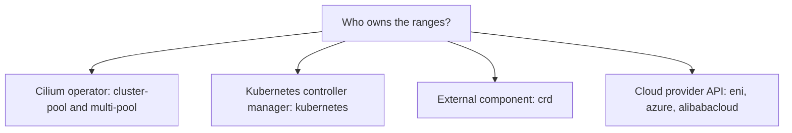

# Other IPAM Modes And How To Choose

Cluster-pool is the default of the Cilium Helm chart, but it is not the only choice. Some clusters already have an address plan, a cloud network or an external tool that hands out ranges. Cilium supports these cases with other modes. This part compares the modes by one question: who owns the ranges, and who hands out the addresses?

## Kubernetes host-scope

In kubernetes mode, which is also called host-scope, Kubernetes itself assigns ranges. The kube-controller-manager gives each node a `spec.podCIDR` field. This works only if the controller manager runs with node CIDR allocation switched on. The Cilium agent reads the field of its node and allocates pod addresses from it.

The operator does not allocate ranges in this mode. The advantage is that standard Kubernetes tooling stays in charge. The limit is that the pool is one fixed range for the whole cluster, and the Kubernetes field cannot hold more than one range per address family.

## CRD-backed mode

In crd mode, an external component writes the ranges into the `CiliumNode` objects, and the agent uses what it finds there. Cilium itself does not decide the ranges. The mode fits clusters where an own controller or an operator for a cloud network plans addresses. The component must keep each pod address unique and must write a range before pods start on a node.

## Cloud modes

The cloud modes draw pod addresses from the network of the cloud provider.

- `eni` uses elastic network interfaces on AWS. The operator attaches interfaces to nodes and gives pods addresses from the subnets of the virtual network, so pods have addresses that the virtual network routes natively.
- `azure` does the same with the Azure networking API.
- `alibabacloud` does the same on Alibaba Cloud.

In these modes the operator calls the cloud API, so it needs credentials and permissions, and the number of pods per node depends on cloud limits such as the number of interfaces and addresses per interface.

## Multi-pool

Multi-pool mode lets a cluster hold several pools and choose the pool per workload through an annotation. The operator carves slices for each node from each pool. This mode is the subject of its own module and is useful when different teams or workloads need different address ranges.

## Comparing the modes



Choose by the constraints you have. If pods must be addressable in an existing network, use a cloud mode or a pool that is part of that address plan. If you want the simplest setup, use cluster-pool. If Kubernetes tooling must stay in charge of ranges, use kubernetes mode. If workloads need separate ranges, use multi-pool.

## Try it

Look at the settings that belong to the mode in the playground.

<!-- astrona:playground:renew -->

First read the mode that the agent uses.

```sh
kubectl -n kube-system get configmap cilium-config -o jsonpath='{.data.ipam}{"\n"}'
```

Now compare the Kubernetes view of the node range with the Cilium view.

```sh
kubectl get nodes -o custom-columns=NAME:.metadata.name,K8S_PODCIDR:.spec.podCIDR
kubectl get ciliumnodes -o custom-columns=NAME:.metadata.name,CILIUM_CIDR:.spec.ipam.podCIDRs
```

In cluster-pool mode the pods use the Cilium ranges. If the Kubernetes `spec.podCIDR` field has a value, it comes from the control plane of the cluster and Cilium does not use it. In kubernetes mode, the agent would use that field and the `CiliumNode` range would follow it.

Last, ask the agent what it reports for address management.

```sh
kubectl -n kube-system exec daemonset/cilium -c cilium-agent -- cilium-dbg status
```

Read the line about IPAM in the output. It shows the allocated addresses and the range in use.

## Changing the mode

Changing the IPAM mode of a running cluster is a disruptive operation. Existing pods keep the addresses they have, but new pods follow the new rules, and the old and new ranges may overlap. Plan the mode before you install, and migrate with a documented procedure and a maintenance window when you must change it.

## Questions to ask before you choose

A short list of questions makes the choice concrete.

- Must pod addresses be routable outside the cluster without translation? Cloud modes and carefully planned pools fit this need.
- How many nodes will the cluster have, and how many pods per node? The answer gives the pool size and the slice size.
- Does a team or tool already own the address plan? If yes, use a mode that accepts its ranges, such as kubernetes or crd mode.
- Do different workloads need separate ranges, for example for firewall rules at the edge? Multi-pool fits this need.

The answers rarely change during the life of a cluster, which is why the mode is chosen before installation.

## What to remember

The modes differ by the owner of the ranges: the Cilium operator for cluster-pool and multi-pool, the Kubernetes controller manager for kubernetes mode, an external component for crd and the cloud API for the cloud modes. In all of them the agent hands out single addresses from the range of its node. Pick the mode that matches your address plan and treat a later change as a migration.

## Common pitfalls

> [!WARNING]
> The `spec.podCIDR` of a Kubernetes node does not tell you where the pod addresses come from. Read the `ipam` key in `cilium-config` and the `CiliumNode` object, because they decide the real ranges.
