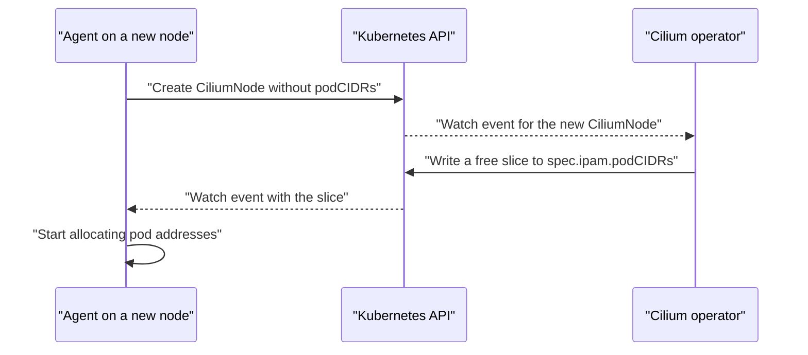

# How The Operator Allocates Node Ranges

A node cannot start pods until it has an address range. This part explains how the range reaches the node, in which order the objects change, and what you can read from them while it happens or when something is wrong.

## The order of events

When a new node joins, three things happen in sequence.

- The Cilium agent starts on the node and creates a `CiliumNode` object with the name of the node. At this time the object has no pod range.
- The operator sees the new `CiliumNode`, picks a free slice from the pool and writes it into `spec.ipam.podCIDRs`.
- The agent sees the update on its own `CiliumNode`, configures its local allocator with the slice and marks the node ready for pods.

Until the third step completes, a pod that is scheduled on the node waits in `ContainerCreating`, because the CNI call has no address to give. This delay is normal for a few seconds after a node joins.



## What the operator tracks

The operator keeps the list of free and used slices in memory and rebuilds it from the existing `CiliumNode` objects when it starts. A restart of the operator therefore does not lose allocations. While the operator is down, nodes that already have a range keep working, and new nodes wait until the operator is back.

When a node is deleted, the operator removes its allocation from the memory and returns the slice to the pool. Do not delete a `CiliumNode` by hand for a node that still exists, because the agent would create a new one and the operator would assign a slice again, possibly a different one.

## What the CiliumNode records

The `CiliumNode` object is the shared record between the operator and the agent.

- `spec.ipam.podCIDRs` is the list of slices that the operator allocated to this node.
- `spec.addresses` lists the node addresses.
- `status.ipam` reports how the agent uses the range, including addresses in use.

The names of these fields matter, because the exam asks where the range of a node is stored. The answer is `spec.ipam.podCIDRs` of the `CiliumNode`, and not the `spec.podCIDR` of the Kubernetes node.

## Try it

Follow the allocation in the playground.

<!-- astrona:playground:renew -->

Read the range of every node.

```sh
kubectl get ciliumnodes -o custom-columns=NAME:.metadata.name,CIDR:.spec.ipam.podCIDRs,INTERNAL_IP:.spec.addresses[0].ip
```

Check which operator pod does the allocation and read its first log lines.

```sh
kubectl -n kube-system get pods -l io.cilium/app=operator -o wide
kubectl -n kube-system logs deployment/cilium-operator --tail=40
```

Look for lines that mention the node names and the allocated ranges. Now read the complete `CiliumNode` of one node.

```sh
kubectl get ciliumnode <node-name> -o yaml
```

Find `spec.ipam.podCIDRs` and the `status.ipam` section. The status shows the addresses that the agent has handed out so far.

## Diagnosing a node without a range

If pods on one node stay in `ContainerCreating`, check these items in order. First, does the `CiliumNode` of that node exist? If not, the agent has not started or cannot reach the API server. Second, does it have `spec.ipam.podCIDRs`? If not, the operator is down or the pool is exhausted, and the operator log says which. Third, does the agent report that it received the range? The agent status shows it.

Each question narrows the cause to one component, which is faster than restarting everything.

## Growing a cluster

When you add nodes, the pool must hold enough free slices. Count the nodes you will have in the future, not only today. Each new node needs one slice, and an autoscaler can add many nodes within minutes. A pool that runs out at that moment stops the scale-up in a confusing way: the nodes are ready in Kubernetes but cannot run pods.

The remedy is to append a CIDR to the pool list in the configuration and let the operator pick it up. The operator then has new slices for the next nodes.

## What to remember

The agent creates a `CiliumNode`, the operator writes a free slice into `spec.ipam.podCIDRs`, and the agent starts to allocate from it. The operator rebuilds its view from the existing objects after a restart. The Kubernetes node field `spec.podCIDR` is not the place to read a Cilium range. A node that has no range cannot start pods, and the operator log and the `CiliumNode` show why.

## Common pitfalls

> [!WARNING]
> Do not edit `spec.ipam.podCIDRs` by hand to fix a problem. In cluster-pool mode the operator owns that field and can overwrite or conflict with your change, and an address range that overlaps another node breaks routing silently.
