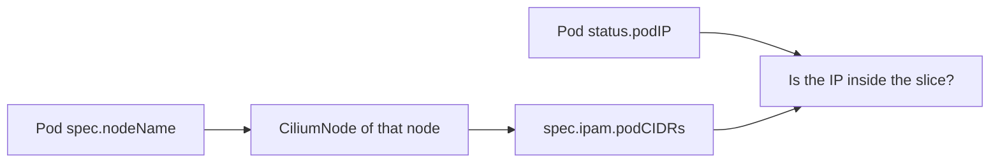

# How The Agent Assigns Pod Addresses

The operator hands a range to a node, but a pod receives only one address from it. The agent on the node makes that choice, and it does so while the CNI `ADD` call waits. This part explains which addresses the agent keeps, how it hands out the rest, and how to prove that a pod address really belongs to its node range.

## The node-local allocator

The agent loads the slice from its `CiliumNode` into an in-memory allocator. When the CNI binary asks for an address, the allocator returns the next free one from the slice and records the owner as the pod name and namespace. When the pod is deleted, the agent releases the address back to the slice.

Because the allocator is local, no network request leaves the node during this step. Starting a pod does not depend on the operator or on other nodes once the range is known. This is why existing nodes keep starting pods while the operator is down.

## Addresses the agent keeps for itself

Not every address in the slice is available to pods. The agent reserves a few. The network address and the broadcast address of the slice are unusable by their nature. The agent also keeps addresses for its own interfaces on the node, such as the address of the `cilium_host` interface, which acts as the gateway of the pods on that node.

For this reason, a `/24` slice does not provide 256 pod addresses. The exact number a node can use is smaller, and the node also has a pod limit in the kubelet, which is often lower. Read the limit that applies to your cluster before you plan the density of pods.

## Proving that an address belongs to a node

A pod address must satisfy two conditions: it lies inside the slice of the node that runs the pod, and no other pod uses it. Checking the first condition takes three facts.

- The address of the pod, from `status.podIP`.
- The name of the node, from `spec.nodeName` of the pod.
- The slice of that node, from `spec.ipam.podCIDRs` of its `CiliumNode`.

If the address is not inside the slice, something is wrong: either the pod uses the host network, or the pod was created before a range change, or the agent hands out addresses from an old range.



## Try it

Prove the link for the pod `shuttle`.

<!-- astrona:playground:renew -->

Read the address and the node of the pod.

```sh
kubectl -n starfleet get pod shuttle -o jsonpath='{.status.podIP}{"\n"}{.spec.nodeName}{"\n"}'
```

Read the slice of that node and compare. Replace `<node-name>` with the second line from the previous command.

```sh
kubectl get ciliumnode <node-name> -o jsonpath='{.spec.ipam.podCIDRs}{"\n"}'
```

The address of the pod lies inside the slice. Now ask the agent on that node which endpoints it knows and with which addresses.

```sh
kubectl -n kube-system get pods -l k8s-app=cilium -o wide
kubectl -n kube-system exec <agent-pod> -c cilium-agent -- cilium-dbg endpoint list
```

The endpoint list shows the IPv4 address of each endpoint on that node. All of them are inside the same slice, except for the endpoints of the host and the health check, which have their own special addresses.

## What happens when an address is released

When a pod is deleted, the agent frees its address, and a later pod can receive the same address. Because of this reuse, an old address in a log or an old firewall rule does not identify one specific workload. Cilium identity solves this, because it follows the labels and not the address.

Do not rely on a fixed address for a restarted pod. The allocator decides at the time of the call, and the result depends on which addresses are free on that node and on which node the scheduler places the new pod.

## Diagnosing a pod without an address

If a pod stays in `ContainerCreating` and the events mention the network plugin, ask these questions. Does the node have a range? Is the slice full? Is the agent on that node ready? The answers lead to the operator, to the pool size or to the agent. Fixing the cause in the right component is much faster than recreating the pod.

## Host-network pods

A pod that sets `hostNetwork: true` does not receive an address from the slice. It shares the network namespace of the node and uses the node address. The agent does not create an endpoint for such a pod, which is why its `CiliumEndpoint` does not exist. When you compare pod addresses with node slices, leave host-network pods out of the comparison.

## Reading usage from the CiliumNode

The status of the `CiliumNode` shows how the agent uses its range. Read it when you need to know how full a node is, before you add more pods to it.

```sh
kubectl get ciliumnode <node-name> -o jsonpath='{.status.ipam}{"\n"}'
```

The status lists the addresses in use and the pods that own them. Compare the count with the size of the slice, and you know how much room is left on that node. A node whose slice is almost full cannot start more pods, even if its CPU and memory are free.

## What to remember

The agent allocates one address per pod from the slice of its node and releases it at deletion. It keeps some addresses for itself, so a slice offers fewer addresses than its size. A pod address belongs to the range recorded in the `CiliumNode` of the node that runs the pod. When an address does not match, check host networking, a range change and the agent state.

## Common pitfalls

> [!WARNING]
> Do not use pod IP addresses as stable identifiers in firewall rules, allow lists or documentation. The agent reuses addresses after a pod is deleted, so the same address can belong to a different workload tomorrow.
