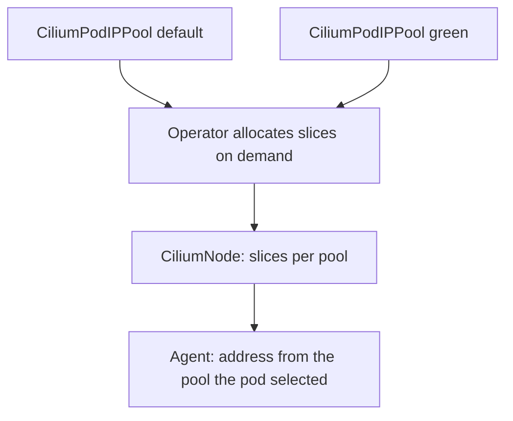

# Pools And Pool Selection

In cluster-pool mode all pods draw from the same ranges. Multi-pool mode keeps several named pools side by side. Each pool has its own ranges and its own slice size, and each pod gets an address from exactly one pool. This part explains the pool object, how nodes receive ranges from several pools and how a workload chooses its pool.

## The CiliumPodIPPool object

A `CiliumPodIPPool` is a cluster-scoped custom resource in the API group `cilium.io/v2alpha1`. The name of the object is the name of the pool. The fields that matter are in `spec.ipv4`:

- `cidrs` is a list of address ranges that belong to the pool.
- `maskSize` is the prefix length of the slice that each node receives from this pool.

An IPv6 pool uses `spec.ipv6` with the same two fields. Pools are independent of each other, so one pool can have `/24` slices and another `/28` slices.

The Helm chart can create pools at install time with the value `ipam.operator.autoCreateCiliumPodIPPools`. You can also create or add pools later with a normal manifest, which is the common way to add a range without reinstalling.

## Node ranges per pool

In cluster-pool mode, a node has one list of ranges. In multi-pool mode, it has one list per pool. The operator watches the pods that need addresses from a pool on a node and allocates a slice of that pool to the node when it is needed. The result is recorded in the `CiliumNode` object, in the section `spec.ipam.pools`, with the slices per pool.

The agent allocates single addresses from the slice of the right pool at the time of the CNI `ADD` call. A node therefore holds slices only for pools that its pods actually use.



## Selecting a pool

The annotation `ipam.cilium.io/ip-pool` selects the pool by name. You can set it in two places.

- On a pod, in the metadata of the pod or the pod template of a Deployment. It applies to that pod.
- On a namespace. It applies to every new pod in that namespace.

If a pod has its own annotation, it takes precedence over the namespace annotation. A pod without an annotation in a namespace without one uses the pool named `default`, so a pool with that name must exist.

## Try it

Create a new pool and place a workload in it.

<!-- astrona:playground:renew -->

Look at the existing pools first.

```sh
kubectl get ciliumpodippools
kubectl get ciliumpodippool green -o yaml
```

Save this as `pool-violet.yaml`.

```yaml
apiVersion: cilium.io/v2alpha1
kind: CiliumPodIPPool
metadata:
  name: violet
spec:
  ipv4:
    cidrs:
    - 10.40.0.0/16
    maskSize: 24
```

Apply it and check that it exists.

```sh
kubectl apply -f pool-violet.yaml
kubectl get ciliumpodippools
```

Now create a namespace that selects the pool and start a pod in it.

```sh
kubectl create namespace bridge
kubectl annotate namespace bridge ipam.cilium.io/ip-pool=violet
kubectl -n bridge run tester --image=curlimages/curl:8.22.0 --command -- sleep 3600
```

Wait for the pod to be ready, and read its address.

```sh
kubectl -n bridge wait --for=condition=Ready pod/tester --timeout=120s
kubectl -n bridge get pod tester -o jsonpath='{.status.podIP}{"\n"}'
```

The address comes from `10.40.0.0/16`. Read the `CiliumNode` of the node that runs the pod, and find the `violet` slice in `spec.ipam.pools`.

## Why the pool matters outside the cluster

A separate pool makes the address of a workload predictable by range. A firewall at the edge of the network can allow `10.40.0.0/16` to reach a database, and every pod in the namespace `bridge` matches this rule. The rule does not need a change when pods come and go. Remember that this controls only the address range. Policy by identity is still the tool for traffic control inside the cluster.

## What to remember

A `CiliumPodIPPool` has CIDRs and a slice size. The operator gives each node slices of a pool on demand and records them per pool in the `CiliumNode`. The annotation `ipam.cilium.io/ip-pool` on a pod or a namespace chooses the pool, and a pod annotation wins over a namespace annotation. A missing annotation means the pool `default`.

## Common pitfalls

> [!WARNING]
> The name in the annotation must match an existing pool exactly. A misspelled name does not fall back to the default pool. The pod stays in `ContainerCreating` and the events show an allocation error.
