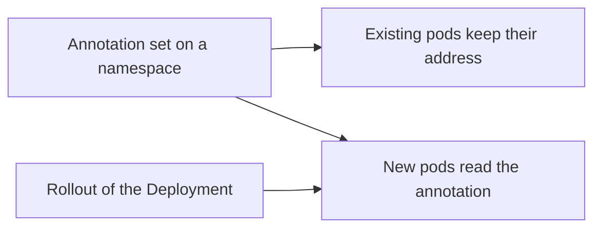

# Requirements, Limits And Moving Workloads

Multi-pool mode gives flexibility, and that has a cost. The network under the nodes must be able to carry the pool ranges, the annotation has timing rules, and moving a workload to another pool needs a restart of its pods. This part lists these points so that a change in a real cluster does not surprise you.

## Routing requirements

A pod address from any pool must be reachable from other nodes. In cluster-pool mode the node ranges come from one planned area, and the routes between nodes are simple to derive. In multi-pool mode the slices of one node come from several pools, and they can lie in unrelated ranges.

The playground therefore runs multi-pool mode with native routing, which means that pod packets leave the node without a tunnel and the underlying network must know how to reach each slice. It uses the setting `auto-direct-node-routes`, which lets each agent install a route to the slices of the other nodes. This works when all nodes share one layer 2 network. Check the documentation of your Cilium release for the routing modes that multi-pool mode supports, because this part of the feature has changed between releases.

Also keep the native routing CIDR wide enough. The playground sets `ipv4-native-routing-cidr` to `10.0.0.0/8`, so that all pool ranges are inside it. Traffic to an address inside this CIDR is not masqueraded, and pods keep their own source address.

## When the annotation is read

The agent reads the annotation when it creates the pod. It does not read it again later. Four consequences follow.

- Adding or changing a namespace annotation does not change the address of a pod that already runs.
- Editing the annotation on a running pod does nothing for that pod.
- A pod gets a new address only when it is created again. For a Deployment, a rollout creates new pods from the template.
- To change the pool of a Deployment, set the annotation in the pod template, because that change itself triggers a rollout.



## Moving a workload to another pool

The safe way to move a Deployment has four steps. First, make sure the target pool exists and has room on the nodes. Second, set the annotation on the namespace or in the pod template. Third, start a rollout so that new pods are created. Fourth, check the new addresses and then check everything that depended on the old addresses, such as firewall rules and allow lists.

During the rollout, old and new pods run side by side with addresses from two pools. Policy by identity keeps working, because the identity does not depend on the address.

## Try it

Move a workload in the playground.

<!-- astrona:playground:renew -->

Create a new namespace with a Deployment, then compare the address of its pod before and after the annotation. The pool `green` already exists in the playground.

```sh
kubectl create namespace dock
kubectl -n dock create deployment relay --image=curlimages/curl:8.22.0 -- sleep 3600
kubectl -n dock rollout status deployment/relay
kubectl -n dock get pods -o wide
```

The pod has an address from the pool `default`. Now annotate the namespace and check the pod again.

```sh
kubectl annotate namespace dock ipam.cilium.io/ip-pool=green
kubectl -n dock get pods -o wide
```

The address of the running pod did not change. Start a rollout, and compare once more.

```sh
kubectl -n dock rollout restart deployment/relay
kubectl -n dock rollout status deployment/relay
kubectl -n dock get pods -o wide
```

The new pod has an address from `10.20.0.0/16`. This is the behaviour to remember: the annotation takes effect for new pods only.

## Limits

Keep a few limits in mind when you plan pools. A pool that is used by pods cannot be removed safely. Each pool uses slices on every node that has pods in it, so many small pools on many nodes can waste address space. A pool that is full on one node blocks new pods of that pool on that node, although other pools on the node still have room.

Plan the number of pools and their slice sizes together with the number of pods you expect per node in each pool.

## Checking the slices of a node

After a rollout you can see how the node holds slices of two pools. Read the pools section of the `CiliumNode` of the node that runs the new pod.

```sh
kubectl get ciliumnode <node-name> -o jsonpath='{.spec.ipam.pools}{"\n"}'
```

The section lists the pool names with the slices allocated to this node. A pool that the node has not used yet is absent, and it appears after the first pod of that pool starts there. This on-demand allocation explains why the first pod of a new pool on a node can take a moment longer to start than the following ones.

## What to remember

Multi-pool mode needs a routing setup that can carry slices from several ranges. The agent reads the pool annotation at pod creation only, so running pods keep their address until they are recreated. Moving a workload means setting the annotation and rolling out the Deployment, and checking everything that depended on the old addresses afterwards.

## Common pitfalls

> [!WARNING]
> Annotating a namespace does not move its running pods, and a test that looks only at the namespace annotation will pass while the pods keep their old addresses. Always read the real pod address after the rollout.
