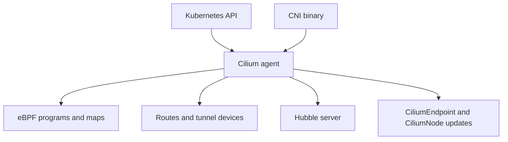

# What The Agent Does On Every Node

A cluster has many nodes, and every node needs its own network configuration: interfaces for its pods, an address range, kernel programs and policy maps. The Cilium agent is the program that creates and maintains all of it on one node. This part lists the tasks of the agent and explains how it is deployed.

## One agent per node

The agent runs as a pod of the DaemonSet `cilium`. A DaemonSet runs one pod on every node, so each node has exactly one agent. The pod uses the host network namespace and holds extra Linux capabilities, because it must create network interfaces, load eBPF programs and change routes on the node. Pods of applications never talk to the agent directly.

Each agent works for its own node. It does not need to ask other agents for permission to start a pod. What the agents share, they share through the Kubernetes API: `CiliumNode`, `CiliumEndpoint`, `CiliumIdentity` and the policy objects.

## The tasks of the agent

The agent has a list of tasks, and the names of the tasks are what you need for the exam.

- It answers the CNI `ADD`, `DEL` and `CHECK` calls through a local socket.
- It allocates pod addresses from the range of its node.
- It creates the endpoint for each pod, with its interface, identity and policy state.
- It watches Services, EndpointSlices, nodes, pods and policy objects in the API server.
- It translates policy into identities and writes them into per-endpoint policy maps.
- It loads, updates and replaces the eBPF programs and maps on the node.
- It sets up routing or tunnel devices for the datapath mode in use.
- It runs the Hubble server that records flows for its node.
- It checks the health of the node connectivity and reports it.



## Containers in the agent pod

The agent pod has more than one container. The container `cilium-agent` is the main one. Init containers run before it and prepare the node, for example to copy the CNI binary into the host directory, to mount the BPF file system and to clean up state from an earlier version. The BPF file system is a special mount where the kernel keeps pinned maps, so maps survive an agent restart.

Some releases run the Envoy proxy for HTTP-aware policy in a separate DaemonSet and not inside the agent. Look at the DaemonSets in `kube-system` to see which layout your release uses.

## Try it

Look at how the agent is deployed.

<!-- astrona:playground:renew -->

List the DaemonSet and the pods with their nodes.

```sh
kubectl -n kube-system get daemonset
kubectl -n kube-system get pods -l k8s-app=cilium -o wide
```

Each node has one pod of the DaemonSet `cilium`. Now read the containers, the init containers and the host paths of the agent pod.

```sh
kubectl -n kube-system get daemonset cilium -o jsonpath='{.spec.template.spec.initContainers[*].name}{"\n"}'
kubectl -n kube-system get daemonset cilium -o jsonpath='{.spec.template.spec.hostNetwork}{"\n"}'
kubectl -n kube-system get daemonset cilium -o jsonpath='{.spec.template.spec.volumes[*].hostPath.path}{"\n"}'
```

The second command prints `true`, because the agent uses the host network. The host paths include the BPF file system, the control group directory and the CNI directories. Last, ask the agent for its status.

```sh
kubectl -n kube-system exec daemonset/cilium -c cilium-agent -- cilium-dbg status
```

Read the sections of the output one by one. They cover the Kubernetes connection, the datapath mode, the address allocation, the controllers, the proxy and the health of the node connectivity.

## The agent API

The agent exposes a REST API on a Unix socket on the node. The `cilium-dbg` tool and the CNI binary both use it. This is why `cilium-dbg` works only from inside the agent pod or on the node, and why the CNI binary needs no credentials: the socket is local and reachable by root only.

The agent also publishes metrics in the Prometheus format on a port of the host network when metrics are enabled, and it serves a health endpoint that the kubelet uses for its probes. A failing health probe makes the kubelet restart the agent.

## What to remember

The agent is a DaemonSet with host network and elevated privileges. It answers the CNI calls, allocates addresses, builds endpoints, resolves policy to identities, loads eBPF programs and maps, sets up routes or tunnels and runs the Hubble server. It talks to the rest of the cluster only through the Kubernetes API and to the node through its local socket.

## Agent and node lifecycle

The agent starts with the node and stops with it. When a node joins the cluster, the DaemonSet controller schedules an agent pod on it. The agent then registers a `CiliumNode` object for the node, which carries the node addresses and, depending on the IPAM mode, its pod address ranges.

When a node is removed, its agent disappears with it, and the operator later removes the stale `CiliumNode` object. This is why the agent can be treated as part of the node and not as a separate service.

## Common pitfalls

> [!WARNING]
> Do not delete the agent pod of a node as a routine fix. The pod is recreated by the DaemonSet, but new pods on that node cannot start while it is down. Use a rolling restart of the DaemonSet and watch the readiness.
