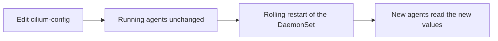

# Configuration, Restarts And Debugging

A configuration change is only useful if it reaches the component that must follow it. For the agent, this takes two steps, and a missing step is a common mistake. This part explains where the agent reads its settings, what a restart changes and what it leaves untouched, and how to look into an agent that does not behave.

## Where the settings live

The agent reads its configuration from the ConfigMap `cilium-config` in `kube-system`. Each key is one setting, and each value is a string. Examples are `ipam`, `routing-mode`, `kube-proxy-replacement` and `debug`. The Helm chart renders the ConfigMap from the values you pass, and the agent pods mount it as files or environment values.

The agent reads these files when it starts. A change in the ConfigMap does not reach a running agent. Because of this, a setting that you change takes effect only after the agent pods restart. The operator reads the same ConfigMap in the same way, so it follows the same rule.



## Restarting the agents

A rolling restart replaces the agent pods one at a time. The command `kubectl rollout restart daemonset/cilium` adds an annotation to the pod template, and the DaemonSet controller then replaces the pods according to its update strategy. The strategy limits how many nodes are without a ready agent at the same time.

During a restart of the agent on a node, the traffic of running pods continues. The eBPF programs and the maps stay in the kernel, because the maps are pinned on the BPF file system. When the new agent starts, it restores its endpoints, compares the state with the API and regenerates programs where needed. New pods on the node and policy changes wait until the agent is ready again.

## Debug logging

The key `debug` in `cilium-config` switches on detailed logging of the agent. The logs then include many more details about endpoints, identities and policy. Debug logging produces a lot of output and costs CPU, so switch it on for an investigation and off afterwards. Setting it needs the two steps from above: change the key, then restart the agents.

## Looking into an agent

Four tools cover most cases.

- `kubectl -n kube-system logs <agent-pod> -c cilium-agent` prints the log of the agent.
- `cilium-dbg status` prints the summary of its state, and `cilium-dbg status --verbose` adds details.
- `cilium-dbg config` prints the configuration values that this agent runs with, which is how you check that a restart took effect.
- `kubectl -n kube-system describe pod <agent-pod>` shows events, restarts and probe failures.

## Try it

Restart the agents and watch the effect on a request loop.

<!-- astrona:playground:renew -->

Start a loop in one terminal that requests `probe` from `shuttle` once per second.

```sh
kubectl -n starfleet exec shuttle -- sh -c 'while true; do curl -s -m 2 -o /dev/null -w "%{http_code}\n" http://probe.starfleet:9898/healthz; sleep 1; done'
```

In a second terminal, restart the DaemonSet and wait for it.

```sh
kubectl -n kube-system rollout restart daemonset/cilium
kubectl -n kube-system rollout status daemonset/cilium --timeout=300s
```

The loop keeps printing the code 200 during the restart, because the kernel programs stayed in place. Stop the loop with Ctrl+C. Read the update strategy and the annotation that the restart added.

```sh
kubectl -n kube-system get daemonset cilium -o jsonpath='{.spec.updateStrategy}{"\n"}'
kubectl -n kube-system get daemonset cilium -o jsonpath='{.spec.template.metadata.annotations}{"\n"}'
```

The annotation `kubectl.kubernetes.io/restartedAt` holds the time of the restart. Last, read the setting the agent runs with.

```sh
kubectl -n kube-system exec daemonset/cilium -c cilium-agent -- cilium-dbg config
```

The output lists the runtime options of the agent, including whether debug is on.

## When an agent does not become ready

If an agent pod stays unready, start with its events and log. Typical causes are a missing kernel feature, a wrong value in `cilium-config`, an unreachable API server or a failure to mount the BPF file system. The log line before the first error usually names the cause. A readiness failure on one node does not affect other nodes, but it stops new pods on the failing node.

## What to remember

The agent reads `cilium-config` at start, so a change needs a rolling restart. During a restart the pinned kernel programs keep forwarding the traffic of running pods, and only new pods and policy changes wait. Debug logging is a setting like any other. For an investigation, use the agent log, `cilium-dbg status`, `cilium-dbg config` and the pod events, and query the agent of the node that you care about.

## Settings and the Helm release

Most clusters manage `cilium-config` through Helm. A manual edit of the ConfigMap works for a test, but the next Helm upgrade renders the ConfigMap again from the chart values and replaces the edit. For a permanent change, change the Helm values and upgrade the release. The upgrade changes the ConfigMap and, for most settings, restarts the agents through a checksum annotation on the pod template.

## Common pitfalls

> [!WARNING]
> After you change `cilium-config`, confirm with `cilium-dbg config` that the agent really runs with the new value. A changed ConfigMap with an unchanged agent is the most common reason for "the setting has no effect".
