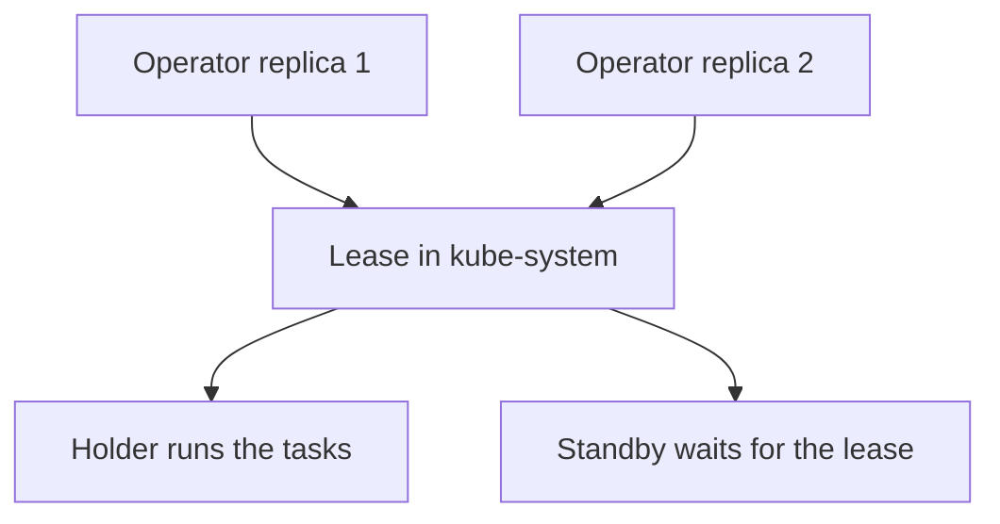

# The Cilium Operator

Some tasks cannot be done by a single agent, because they need a view of the whole cluster or because they must run exactly once. The Cilium operator does these tasks. This part lists them, explains how several operator replicas share the work and describes what you lose when the operator is not running.

## Where the operator runs

The operator is the Deployment `cilium-operator` in the namespace `kube-system`. Unlike the agent, it does not run on every node. It uses the host network, so it opens its ports on the node it runs on. Because of this, two replicas cannot run on the same node, and the chart adds a pod anti-affinity rule that keeps replicas apart.

The operator never handles application traffic. A node does not need the operator to forward packets, enforce policy or translate Services.

## The tasks of the operator

The tasks depend on the features that you enable. The main ones are these.

- It registers the Cilium custom resource definitions when it starts, so the API knows the Cilium object types.
- In cluster-pool and multi-pool IPAM modes, it allocates address ranges to nodes and writes them into `CiliumNode` objects. In cloud IPAM modes, it calls the cloud API to attach addresses.
- It removes `CiliumNode` objects of nodes that no longer exist.
- It removes `CiliumIdentity` objects that no endpoint uses, and `CiliumEndpoint` objects whose pod is gone.
- It can manage features such as load balancer IP pools, and the Gateway API and Ingress resources when those features are on.

These tasks keep the shared state clean and give new nodes their ranges. None of them is on the packet path.

## Leader election

When you run several replicas, only one may do the work at a time, otherwise two operators could allocate the same slice to two nodes. The replicas therefore use leader election. Each replica tries to hold a Lease object in `kube-system`. A Lease is an API object that records a holder name and a renewal time. The replica that holds it is the leader and runs the tasks. The others stay in standby and watch the lease.

If the leader stops, it stops renewing the lease. After the lease duration ends, a standby replica takes it over and continues. The switch takes some seconds, during which the operator tasks pause.



## What stops when the operator is down

When the operator is not running, existing pods continue to run and to communicate. Policy changes still reach the agents, because the agents handle them. The functions that stop are those listed above. New nodes get no address range in cluster-pool mode, and pods on those nodes cannot start. Stale objects stay until the operator returns. The effect is gradual, which is why a short operator outage often goes unnoticed and a long one hurts only when the cluster changes.

## Try it

Look at the operator and its lease.

<!-- astrona:playground:renew -->

Read the Deployment and the pod.

```sh
kubectl -n kube-system get deployment cilium-operator
kubectl -n kube-system get pods -l io.cilium/app=operator -o wide
kubectl -n kube-system get deployment cilium-operator -o jsonpath='{.spec.template.spec.hostNetwork}{"\n"}'
```

The last command prints `true`. Now read the affinity rule and the lease.

```sh
kubectl -n kube-system get deployment cilium-operator -o jsonpath='{.spec.template.spec.affinity}{"\n"}'
kubectl -n kube-system get leases
```

The affinity section keeps replicas on different nodes. The lease list includes the Cilium operator lease, and its holder identity names the pod that leads. Last, read the start of the operator log.

```sh
kubectl -n kube-system logs deployment/cilium-operator --tail=30
```

## Running more than one replica

A second replica removes the single point of failure of the operator. The replicas need free nodes, one per replica, because of the host network and the anti-affinity rule. In a cluster that has fewer nodes than replicas, the extra replicas stay in `Pending`. The Helm value `operator.replicas` sets the count. Scaling the Deployment directly with `kubectl scale` also works, but the next Helm upgrade resets it to the chart value.

## What to remember

The operator is a Deployment that does cluster-wide tasks: it registers the custom resources, allocates ranges to nodes in some IPAM modes and removes stale objects. Replicas use a Lease for leader election, and a standby takes over if the leader stops. Without the operator, existing traffic and policy keep working, and new nodes and cleanup wait.

## Operator and the agents compared

The two components have different scopes. An agent works for one node and knows its pods and endpoints. The operator works for the whole cluster and knows nodes and shared objects. An agent acts when a pod appears on its node, and the operator acts when the shape of the cluster changes, for example when a node joins or leaves.

Because of this split, a problem on one node usually points to its agent, and a problem that affects new nodes or leaves stale objects points to the operator. Check the matching component first.

The operator also reads `cilium-config`, like the agents. A change in IPAM settings therefore needs a restart of the operator as well as of the agents.

## Common pitfalls

> [!WARNING]
> Scaling the operator beyond the number of nodes leaves replicas in `Pending`, because each replica needs its own node. Check the node count first, and set the replica count in the Helm values so that an upgrade does not undo it.
