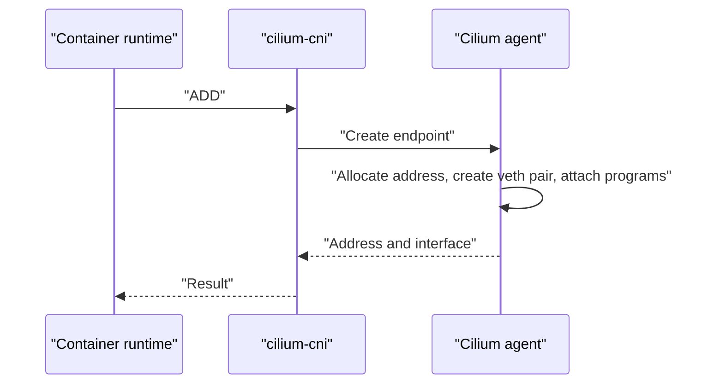

# The CNI Plugin And Pod Creation

The container runtime does not know about Cilium. It knows only that it must call whatever plugin the CNI configuration names. This part follows the chain from the files on the node to the endpoint of a new pod, and explains what happens when the chain breaks.

## What the agent installs on a node

When the agent pod starts on a node, an init container copies the `cilium-cni` binary into the CNI binary directory of the node, usually `/opt/cni/bin`. The agent also writes a CNI configuration file into the CNI configuration directory, usually `/etc/cni/net.d`. The runtime reads this directory and uses the plugin that the file names. If several files exist, the runtime uses the first one in alphabetical order, which is why Cilium names its file so that it comes first and disables other plugin files.

The host paths are mounted into the agent pod from the node, which is why you can see them in the volume list of the DaemonSet.

## What the CNI call does

When the kubelet starts a pod, it asks the runtime to create the pod sandbox. The runtime creates a network namespace and runs `cilium-cni` with the operation `ADD`. The binary reads the pod name, the namespace and the namespace path from the call, and sends a request to the agent through the local socket.

The agent then does the following.

- It allocates an address from the range of the node.
- It creates a veth pair, moves one end into the pod network namespace and sets address and routes inside the pod.
- It creates the endpoint, starts the identity resolution and builds the programs for the host-side interface.
- It answers with the address and the interface details, and the binary returns them to the runtime.

The call returns when the network is usable. Policy can still be pending in the first moments, because the identity of a new pod is resolved after the call. A new endpoint therefore passes through the states `waiting-for-identity` and `regenerating` shortly after the pod starts.



## When the chain breaks

Each link can fail, and each failure has its own sign.

- If the binary or the configuration is missing, the pod stays in `ContainerCreating` and the event says that the network plugin is not ready.
- If the agent is not running or not ready, the call fails or waits, and the kubelet retries it with a delay.
- If the node has no address range, the agent cannot allocate, and the event shows the allocation error.
- If the node is full, the same allocation error appears when the range has no free address.

Pods that already run are not affected by any of these. The CNI call happens only at pod start and stop.

## Keeping pods away from unready nodes

A new node can accept pods before its agent is ready. The scheduler would place pods there, and they would wait for the network. Cilium supports a node taint that the agent removes when it is ready, so the scheduler avoids the node until then. Check your installation to see whether the taint is in use.

## Try it

Follow the chain on the playground cluster.

<!-- astrona:playground:renew -->

Start with the host paths that the agent pod mounts from the node.

```sh
kubectl -n kube-system get daemonset cilium -o jsonpath='{.spec.template.spec.volumes[*].hostPath.path}{"\n"}'
```

Find the CNI directories in the list. Now create a pod and watch the events.

```sh
kubectl -n starfleet run walker --image=curlimages/curl:8.22.0 --command -- sleep 3600
kubectl -n starfleet get events --field-selector involvedObject.name=walker
kubectl -n starfleet get pod walker -o wide
```

The events show the sandbox creation, and the pod receives an address from the node range. Look at the endpoint and the identity that were created for it.

```sh
kubectl -n starfleet get ciliumendpoint walker
```

Delete the pod and check that its endpoint disappears. This shows the `DEL` call and the cleanup.

```sh
kubectl -n starfleet delete pod walker
kubectl -n starfleet get ciliumendpoints
```

## Chaining

Cilium can also run after another plugin in a chain, for example on a cloud network that already provides the interface. In this mode Cilium does not create the interface and does not allocate addresses. It adds its eBPF programs on top of what the first plugin built. This is a special setup for clusters where the first plugin is required, and it limits the features that Cilium can use.

## What to remember

The agent copies `cilium-cni` and its configuration to the node. At pod start the runtime calls the binary with `ADD`, the binary asks the agent, and the agent allocates an address, builds the interface and the endpoint, and answers. If a link is missing, new pods wait in `ContainerCreating` while running pods stay unaffected. The events of the pod name the failing link.

## Common pitfalls

> [!WARNING]
> Do not leave a second CNI configuration file in the directory of a node. The runtime picks the first file in alphabetical order, and a leftover file can take over the network of new pods without any error in Cilium.
