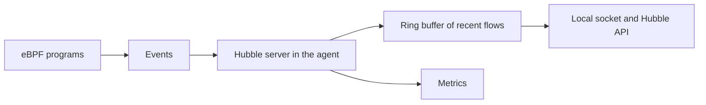

# The Hubble Server And Flows

Without observability, a denied request is only a timeout. Hubble turns it into a record that says who sent the request, who should have received it and why it was dropped. This part explains what that record contains, which component creates it and what limits it.

## What a flow is

A flow is one record of network activity that the datapath saw. Cilium creates it from events of the eBPF programs. The record carries the information that the programs know at that moment. The important fields are these.

- The source and the destination: IP address, port and the labels and identity of each side.
- The names of the pod, the namespace and the node for each side, when they are known.
- The protocol and, for supported protocols, the application layer details such as the HTTP method, the path and the status code, or the DNS name.
- The verdict: `FORWARDED`, `DROPPED`, `ERROR`, `AUDIT` or `REDIRECTED`.
- For a drop, the reason, for example that policy denied the packet.
- The traffic direction and the time.

The names and labels make flows readable. A flow that reads "pod `shuttle` in `starfleet` to pod `probe` in `starfleet`, dropped, policy denied" needs no address lookup.

## Where flows are created

The Hubble server is part of the Cilium agent. It runs on every node and observes the traffic of that node only. When Hubble is enabled, the datapath sends events to the agent, and the Hubble server turns them into flows and stores them in a ring buffer in memory. A ring buffer has a fixed size, and the newest entry replaces the oldest when the buffer is full.

Because the buffer lives in memory and has a fixed size, Hubble is not a long-term store. It answers "what happened in the last minutes", not "what happened last week". For history you export flows or metrics to another system.



## Reading flows on one node

Every agent exposes its Hubble API on a local Unix socket. A client on the same node can read flows from there. The `hubble` command-line client can also connect over the network to the server port of an agent when the server listens on a port. Reading from one agent shows only the traffic of that node, which is rarely enough in a cluster. Pods talk across nodes, and the request that you look for may have passed on the other one.

This is the reason for Hubble Relay, which collects the flows of all nodes and is explained next.

## Metrics

Hubble can also count flows and expose the counters as Prometheus metrics. The configuration decides which metric groups exist, for example DNS, drops, TCP and HTTP. Metrics are cheap to keep for a long time and are the usual input for dashboards and alerts. Flows answer detailed questions about single requests, and metrics answer questions about rates and trends.

## Try it

Check that Hubble is enabled and look at its settings.

<!-- astrona:playground:renew -->

Read the Hubble keys in the agent ConfigMap.

```sh
kubectl -n kube-system get configmap cilium-config -o yaml | grep -i hubble
```

The keys show that the Hubble server is enabled and name its socket and listen address. Now look for Hubble in the agent status.

```sh
kubectl -n kube-system exec daemonset/cilium -c cilium-agent -- cilium-dbg status
```

Find the line about Hubble, which tells you whether the server is running and how many flows it holds. Last, produce some traffic for later exercises.

```sh
kubectl -n starfleet exec shuttle -- curl -s -m 5 -o /dev/null -w '%{http_code}\n' http://probe.starfleet:9898/healthz
kubectl -n outpost exec drifter -- curl -s -m 5 -o /dev/null -w '%{http_code}\n' http://probe.starfleet:9898/healthz
```

Both requests become flows in the ring buffers of the nodes that carried them.

## Enabling Hubble

The server is switched on with the Helm value `hubble.enabled`. It adds settings to the agent configuration, so the agents must restart. Relay, the user interface and the metrics have their own switches, and each one adds its own workloads. Switch on only what you need, because each addition uses resources.

## What to remember

A flow is a record of network activity with identities, names, protocol details and a verdict. The Hubble server in each agent creates flows from datapath events and keeps the most recent ones in a fixed-size ring buffer. A single agent shows only the traffic of its node, and the buffer is not long-term storage. Metrics give long-term numbers, and Relay gives the cluster-wide view.

## Verdicts and drops

The verdict tells you what the datapath did with the traffic. `FORWARDED` means the packet was allowed and sent on. `DROPPED` means it was discarded, and the drop reason says why, for example because policy denied it. `AUDIT` appears when a policy runs in audit mode, where a would-be drop is only recorded. `REDIRECTED` means the traffic was sent to a proxy.

Reading the verdict first is the fastest way to separate a policy problem from a routing problem. A dropped flow with a policy reason points to policy. No flow at all points away from policy, toward routing, DNS or the application.

## Common pitfalls

> [!WARNING]
> An empty result from one agent does not mean that nothing happened. The traffic may have passed on another node, or the ring buffer may have overwritten the flow already. Use Hubble Relay for the cluster view and read recent traffic soon after it happens.
