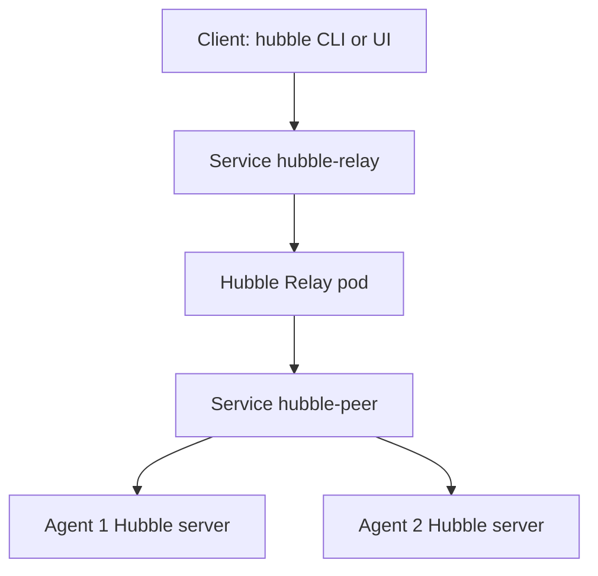

# Hubble Relay, The Peer Service And The UI

A client that wants flows of the whole cluster would have to connect to every agent. Hubble Relay does this for it. This part explains how Relay finds the agents, which Services belong to Hubble and what happens when Relay is not running.

## Hubble Relay

Hubble Relay is a Deployment in `kube-system` called `hubble-relay`. It connects to the Hubble server of every agent, collects the flows and offers them through one API. A client connects to the relay, asks for flows with filters and receives a merged stream that covers all nodes.

Relay stores nothing on its own. It reads the flows from the ring buffers of the agents on request. If an agent is down, its part of the data is missing, and Relay reports which nodes it could not reach.

The relay pod listens on a port of its own, which is 4245 by default, and its Service maps a Service port to that port. The Service is called `hubble-relay`.

## How Relay finds the agents

Relay needs to know which agents exist. It asks the peer service, which is a gRPC service that each agent offers and that returns the list of Hubble servers in the cluster. The Service `hubble-peer` in `kube-system` points to the agent pods. Relay connects to it, receives the list of peers and keeps the list updated when nodes come and go.

Both Services have a purpose. The Service `hubble-peer` is used by Relay to find the agents. The Service `hubble-relay` is used by clients to reach Relay.



## Transport security

The connections between Relay and the agents can use mutual TLS when it is enabled. In mutual TLS both sides present certificates, so Relay proves that it is Relay, and the agent proves that it is an agent. The certificates come from a certificate source that you configure, for example the built-in Helm generation or cert-manager. When TLS is on, a client must trust the certificate authority of the relay for its own connection to Relay if Relay serves TLS.

## The user interface

Hubble UI is a web application with its own Deployment and Service. It connects to Relay, and it shows the service map of a namespace and the recent flows between the services. It is a client like the command-line tool, and it needs Relay to work. If Relay is not available, the UI shows an error.

## Try it

Bring Relay back and read its Services.

<!-- astrona:playground:renew -->

In the playground the relay Deployment starts with zero replicas. Check the state first.

```sh
kubectl -n kube-system get deployment hubble-relay
kubectl -n kube-system get endpoints hubble-relay
```

The Deployment has no ready replica and the Service has no endpoint. Scale the Deployment up and wait for it.

```sh
kubectl -n kube-system scale deployment/hubble-relay --replicas=1
kubectl -n kube-system rollout status deployment/hubble-relay --timeout=180s
```

Read both Services and the endpoint.

```sh
kubectl -n kube-system get service hubble-relay hubble-peer
kubectl -n kube-system get endpoints hubble-relay
```

The endpoint now lists the address of the relay pod. Read the log of Relay to see how it connects to the peers.

```sh
kubectl -n kube-system logs deployment/hubble-relay --tail=30
```

Look for lines that name the peers or report a connection problem. To read flows, forward a local port to the relay Service and point a Hubble client at it.

```sh
kubectl -n kube-system port-forward service/hubble-relay 4245:80
```

The `hubble` command-line client is a separate program that you install on your machine. With the forward running, `hubble status --server localhost:4245` reports the nodes it reaches, and `hubble observe --server localhost:4245 --namespace starfleet` prints recent flows of that namespace.

## Why a missing Relay is easy to miss

If Relay stops, the agents continue to record flows, and the datapath is not affected. Only the cluster-wide read access disappears. Because nothing in the application breaks, a stopped Relay can stay unnoticed until someone needs a flow during an incident. A readiness check or an alert on the Deployment prevents that.

## What to remember

Hubble Relay is a Deployment that merges the flows of all agents into one API. It finds the agents through the Service `hubble-peer` and offers itself through the Service `hubble-relay`. The user interface and the command-line client are clients of Relay. When Relay is down, the datapath keeps working and only the cluster-wide view is lost.

## Common pitfalls

> [!WARNING]
> A Service port is not a container port. The Service `hubble-relay` maps its own port to the relay container port, and a client must use the Service port. Read the port from the Service object and not from the pod.
