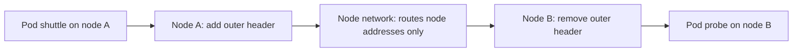

# Encapsulation And The Overlay Datapath

Each node of a cluster owns a range of pod addresses. The network under the nodes, for example a switch or a cloud network, knows the addresses of the nodes, but it usually knows nothing about those pod ranges. This part explains how an overlay solves this problem by hiding the pod addresses inside packets between the nodes.

## The problem

Pod `shuttle` on node A has the address 10.244.0.5, and pod `probe` on node B has the address 10.244.1.7. If `shuttle` sends a packet to `probe` and node A puts it on the network as it is, the switch sees a destination that no route covers. It drops the packet or sends it to a default gateway that does not know the range either.

There are two ways to fix this. You can teach the network the pod ranges, which is native routing. Or you can make the pod packets look like node packets, which is an overlay.

## Encapsulation

Encapsulation means that a complete packet becomes the payload of a new packet. The outer packet has the address of the source node and the address of the destination node. The network under the nodes sees only the outer packet, and the node addresses are known to it. The inner packet is the original pod packet and stays unchanged.

At the destination node, the outer header is removed. This is decapsulation. The inner packet then goes to the destination pod as if it had been sent there directly.



## The path of a packet in tunnel mode

In tunnel mode, Cilium creates a tunnel device on each node. For VXLAN, its name is `cilium_vxlan`. The eBPF program on the pod interface looks up the destination of a packet. If the destination pod is on another node, the program sends the packet to the tunnel device and tells it the address of the destination node.

How does the program know which node holds a pod address? The agent keeps a map, the ipcache, that maps pod addresses to identities and to the node that holds them. The agents fill it from the `CiliumNode` and `CiliumEndpoint` information that they read from the API. Because of this map, no routing protocol and no route per pod is needed in the network.

## What the node network needs

The node network must only deliver the outer packets between node addresses. It must also allow the tunnel port between nodes. For VXLAN, this is UDP port 8472. A firewall between the nodes that blocks this port breaks all cross-node pod traffic while same-node traffic continues.

## Try it

Read the routing mode and see where the two pods run.

<!-- astrona:playground:renew -->

Start with the datapath settings of the agents.

```sh
kubectl -n kube-system get configmap cilium-config -o jsonpath='{.data.routing-mode}{"\n"}'
kubectl -n kube-system get configmap cilium-config -o jsonpath='{.data.tunnel-protocol}{"\n"}'
```

The first value is `tunnel` and the second one names the protocol. Now find the nodes of the pods and their addresses.

```sh
kubectl -n starfleet get pods -o wide
kubectl get nodes -o wide
```

Compare the pod addresses with the node addresses. They come from different ranges. Last, look at the tunnel device on a node through the agent.

```sh
kubectl -n kube-system exec daemonset/cilium -c cilium-agent -- cilium-dbg status
```

The output names the datapath mode and the tunnel protocol in the section about the routing. Send one request across the nodes and check the result code.

```sh
kubectl -n starfleet exec shuttle -- curl -s -m 5 -o /dev/null -w '%{http_code}\n' http://probe.starfleet:9898/healthz
```

## Why an overlay is easy to deploy

An overlay needs almost nothing from the network below. Any network that carries IP between the nodes works, even when the nodes are in different subnets and routers sit between them. This is why tunnel mode is the default in many installations and works on most clouds and on-premises networks without coordination with the network team.

## What an overlay costs

The wrapping has a price. Each packet is larger by the size of the outer headers, and the node spends CPU to add and remove them. Network tools in the middle see only node-to-node UDP traffic and cannot tell which pods talk. Hubble remains able to show the real flows, because it reads them inside the nodes before the wrapping.

## What to remember

An overlay wraps each pod packet in an outer packet between node addresses, so the network below needs no route for pod ranges. The eBPF program uses the ipcache to find the node of the destination pod and hands the packet to the tunnel device. The network only has to deliver UDP between nodes and allow the tunnel port. The price is overhead per packet and less visibility for the network team.

## Return traffic

The reply from `probe` to `shuttle` takes the same steps in the other direction. Node B wraps the reply, the network delivers it to node A, and node A unwraps it. Each direction is handled on its own, so a problem can affect only one of them, for example when a firewall allows the tunnel port in one direction only.

## Common pitfalls

> [!WARNING]
> If same-node pod traffic works and cross-node traffic fails, suspect the path between the nodes first. A firewall that blocks the tunnel port produces exactly this pattern, and the pod configuration is not at fault.
