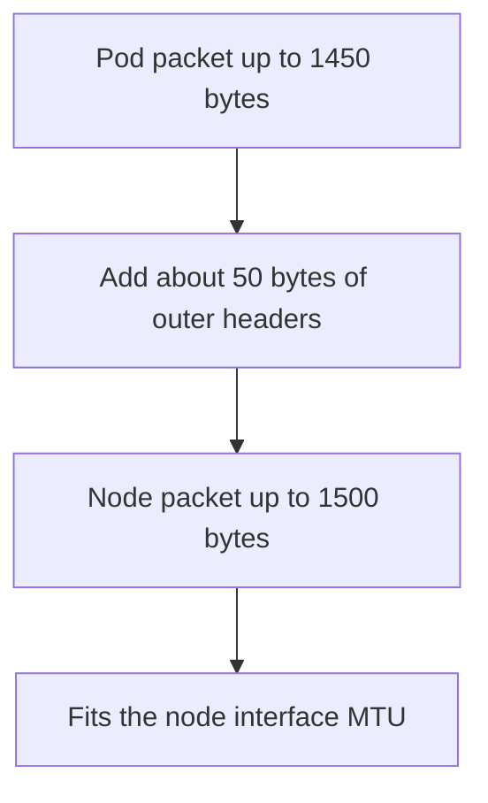

# VXLAN, Geneve And The MTU

Cilium offers two tunnel protocols. They differ in their header format and port, but the effect on a packet is the same: the packet grows. This part describes both protocols, shows how to calculate the cost of the wrapping and explains why the pod interface needs a smaller MTU than the node interface.

## The two protocols

VXLAN stands for Virtual Extensible LAN. It carries a complete Ethernet frame inside a UDP packet and uses an identifier of 24 bits, the VNI, to mark the network. Its default UDP port is 8472 in Cilium. It is the default tunnel protocol of Cilium.

Geneve stands for Generic Network Virtualization Encapsulation. It has the same basic idea but a flexible header that can carry options. Its UDP port is 6081. Cilium can use these options to transport the identity of the source in the tunnel header.

The protocol is selected with the setting `tunnel-protocol`, with the Helm value `tunnelProtocol`. Both ends of a tunnel must use the same protocol, and all nodes of a cluster use the same one.

## Carrying the identity

Policy depends on the identity of the sender. Inside one node the program knows it. Between nodes in tunnel mode, Cilium can put the identity into the tunnel header, so the destination node does not have to look up the sender address. In native routing mode, there is no tunnel header, so the destination node uses the ipcache to map the source address to an identity.

## Overhead and MTU

The MTU, the maximum transmission unit, is the largest packet that an interface sends without fragmenting. If the node interface has an MTU of 1500 bytes, a packet that is 1500 bytes long fills it completely. A VXLAN header adds about 50 bytes: the outer Ethernet, IP, UDP and VXLAN headers. A pod packet of 1500 bytes would become 1550 bytes and would not fit.

For this reason, the pod interface MTU must be smaller than the node MTU by the overhead. With a node MTU of 1500 and VXLAN, a pod MTU of 1450 leaves room for the wrapping. Cilium detects the MTU of the node interface and subtracts the overhead of the selected protocol. The setting `mtu` allows you to set it by hand.



## What happens with a wrong MTU

If the pod MTU is too large, large packets exceed the node MTU after wrapping. They are dropped or fragmented. A typical sign is that small requests succeed while large responses stall. A short `curl` returns quickly, and a download hangs. The cause is hard to see in the application, because the connection itself opens correctly.

## Try it

Read the protocol and the MTU settings.

<!-- astrona:playground:renew -->

Read the tunnel keys from the agent configuration.

```sh
kubectl -n kube-system get configmap cilium-config -o yaml | grep -i -E 'tunnel|mtu'
```

Some keys may be missing when Cilium uses its defaults. A missing key is not an error. Now compare the interface MTUs inside a pod and on the node through the agent pod.

```sh
kubectl -n starfleet exec shuttle -- cat /sys/class/net/eth0/mtu
kubectl -n kube-system exec daemonset/cilium -c cilium-agent -- cat /sys/class/net/eth0/mtu
```

The pod value should be smaller than the node value when a tunnel is in use. The difference is the overhead that Cilium subtracted. Check that the tunnel port of the protocol is listed by the agent.

```sh
kubectl -n kube-system exec daemonset/cilium -c cilium-agent -- cilium-dbg status --verbose
```

Look for the section about the encapsulation or tunnel and compare the port with the numbers in this part.

## Choosing between the protocols

VXLAN is widely supported and used by default, and hardware network cards often offload it. Geneve is more flexible, and its options are the reason to select it when you need them. For most clusters the default is right. Change the protocol only for a reason, and change it on all nodes in one step with an agent restart, because a mixed cluster cannot communicate across nodes.

## What to remember

VXLAN uses UDP 8472 and Geneve uses UDP 6081 in Cilium. Both wrap the pod packet, and VXLAN adds about 50 bytes. The pod MTU is the node MTU minus the overhead, and Cilium sets it automatically. A wrong MTU shows as small requests that work and large transfers that stall. The tunnel protocol is a cluster-wide setting.

## Working out the numbers

The overhead of VXLAN has four parts: the outer Ethernet header of 14 bytes, the outer IPv4 header of 20 bytes, the UDP header of 8 bytes and the VXLAN header of 8 bytes. The sum is 50 bytes. The Ethernet header is not counted against the MTU of the node interface in every case, because the MTU covers the IP packet and not the frame header. In practice, Cilium subtracts the overhead that its datapath adds to the IP packet, and you read the resulting pod MTU from the interface instead of calculating it.

Geneve has a base header of 8 bytes, like VXLAN, and the options add more. Its overhead is therefore at least the same and can be larger when options are in use.

## Jumbo frames

Some networks use an MTU of 9000 bytes on the nodes. The pod MTU follows it, so pods can send larger packets and the overhead is a smaller share of each packet. All devices on the path must support the larger size, otherwise large packets are dropped. Check the whole path before you raise an MTU.

## Reading a stalled transfer

If a large transfer stalls, test with increasing payload sizes from a pod and note the size at which it fails. A failure near the node MTU minus the overhead confirms an MTU problem. A failure at a small size points to a different cause, such as policy or routing.

## Common pitfalls

> [!WARNING]
> Do not raise the pod MTU to match the node MTU in tunnel mode. Large packets then exceed the node MTU after wrapping and are lost, and the symptom looks like a random application timeout.
