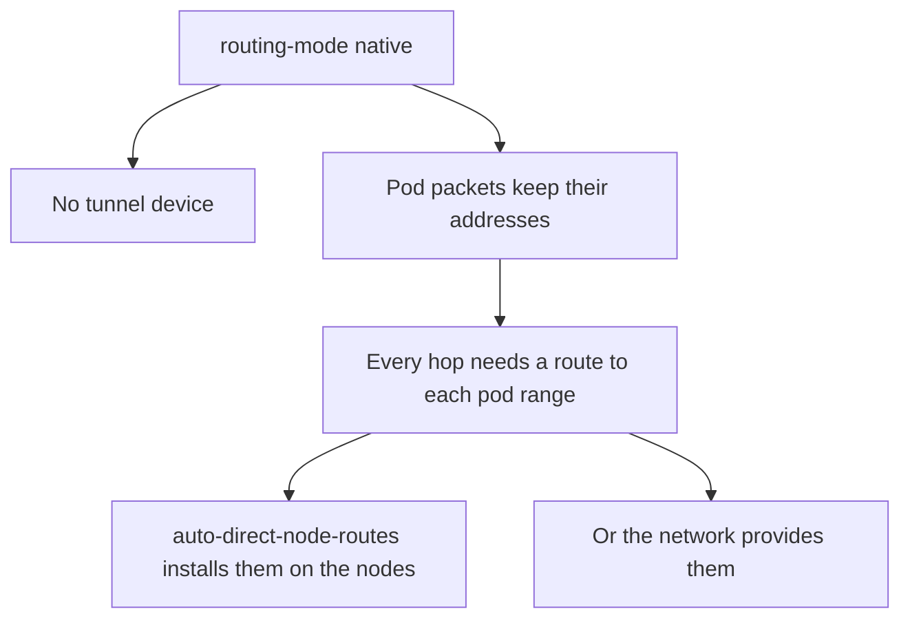

# Requirements And Settings Of Native Routing

Native routing sends pod packets across the network without an outer header. A packet from a pod on node A to a pod on node B has the pod addresses as source and destination from start to finish. This is simple and fast, but it works only when every device on the path can route to the pod ranges. This part lists the requirements and the settings.

## What changes compared to an overlay

Without a tunnel, node A has to forward the packet to node B directly. It needs a route that says: the range of the pods of node B is reached through the address of node B. If this route is missing, node A sends the packet to its default gateway, and the gateway usually has no idea where the range is. The packet is dropped there.

So native routing moves a task from Cilium to the environment: somebody must provide the routes for all pod ranges. Cilium can do it itself in simple networks, and it needs help from the network in other cases.

## The settings

Three settings define the mode.

- `routing-mode` is set to `native`. The default is `tunnel`.
- `ipv4-native-routing-cidr` is a range that covers all pod addresses. The agent does not masquerade traffic to addresses in this range, because they are reachable without translation.
- `auto-direct-node-routes` tells the agent to install routes to the pod ranges of other nodes by itself.

The Helm values are `routingMode`, `ipv4NativeRoutingCIDR` and `autoDirectNodeRoutes`.



## Direct node routes

With `auto-direct-node-routes` set to true, each agent reads the other nodes from `CiliumNode` and adds one route per remote node. The route's destination is the pod range of that node, and the next hop is the node address. After this, the nodes can reach one another's pods through the ordinary routing table.

This has one important condition. A next hop must be reachable directly, which means that the nodes are in the same layer 2 network. If a router sits between two nodes, the next hop address is not in the local subnet, and the node cannot install the route. In that case another route distribution is required.

## Try it

Look at the settings and at the routes on a node.

<!-- astrona:playground:renew -->

Read the three settings.

```sh
kubectl -n kube-system get configmap cilium-config -o jsonpath='{.data.routing-mode}{"\n"}'
kubectl -n kube-system get configmap cilium-config -o jsonpath='{.data.ipv4-native-routing-cidr}{"\n"}'
kubectl -n kube-system get configmap cilium-config -o jsonpath='{.data.auto-direct-node-routes}{"\n"}'
```

The values show the mode, the covering range and whether the agent installs routes. Now see the pod ranges that the nodes own.

```sh
kubectl get ciliumnodes -o custom-columns=NAME:.metadata.name,PODCIDRS:.spec.ipam.podCIDRs
```

Read the routing table inside a node. In a kind cluster each node is a container, so use the container runtime.

```sh
docker exec "$(kubectl get nodes -o jsonpath='{.items[0].metadata.name}')" ip route
```

Look for a route to the pod range of the other node. When the setting is true and the nodes share a network, the route is there. Send a request across the nodes to confirm the result.

```sh
kubectl -n starfleet exec shuttle -- curl -s -m 5 -o /dev/null -w '%{http_code}\n' http://probe.starfleet:9898/healthz
```

## The covering range

The value of `ipv4-native-routing-cidr` must include all pod ranges, and also any other address that is reachable without translation. A range that is too small makes the agent masquerade traffic that it should send unchanged. A range that is too large turns off masquerading for addresses that need it, for example the addresses of the internet.

## What to remember

Native routing needs routes to every pod range on every hop. The settings are `routing-mode`, `ipv4-native-routing-cidr` and `auto-direct-node-routes`. Direct node routes work only when nodes share a layer 2 network. The covering range must include all pod ranges and nothing that needs translation.

## Why the nodes learn each other first

The agent installs a route only for a node that it knows about. It learns of nodes from `CiliumNode` objects, which each agent creates for its own node. A new node therefore becomes reachable after its agent has registered and the other agents have seen the object. During this short time, traffic to pods of the new node may fail.

## Reading the result

A correct setup shows one route per remote node in the routing table of each node. The destination of each route is the pod range of that node, and the next hop is its address. A missing route for one node means that the agent does not know that node, or that the next hop is not in a local subnet.

## Common pitfalls

> [!WARNING]
> If you switch to native routing and leave `auto-direct-node-routes` off without providing routes in another way, all cross-node pod traffic stops. The configuration looks complete, and the failure shows only as timeouts between pods on different nodes.
