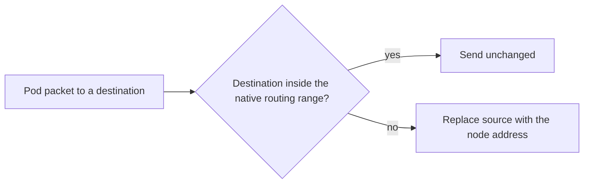

# Route Distribution, BGP And Masquerading

When the nodes are not in one layer 2 network, the direct routes of the agent are not enough. This part describes the other ways to deliver the routes, and then explains masquerading, which decides what source address a pod packet has when it leaves the cluster range.

## Ways to provide the routes

There are four common ways to make the pod ranges known.

- Direct node routes, from the agent, for nodes in one layer 2 network.
- A cloud route table, where the cloud provider holds one route per node range. Some cloud integrations let Cilium or the cloud controller maintain these routes.
- BGP, the Border Gateway Protocol, where each node announces its pod range to the routers, and the routers distribute it. Cilium has its own BGP control plane that can advertise pod ranges to peers.
- Static routes that an administrator enters in the routers.

The choice depends on where the nodes run and who owns the network. All four give the same result: every hop knows the next hop for each pod range.

## BGP in one paragraph

BGP is a protocol in which two neighbours exchange the ranges that they can reach. A node that speaks BGP tells the router: "I hold the range 10.244.1.0/24". The router passes this information on to the other routers and nodes. The routers learn the pod ranges without manual work, and the information changes when nodes come or go. The Cilium BGP control plane is configured with custom resources that describe the peers and the ranges to announce.

## Masquerading

Masquerading means that a node replaces the source address of a packet with its own address when the packet leaves the cluster. Without it, the packet would leave with a pod address, and the destination could not answer to an address that it cannot route.

Cilium masquerades traffic from pods to destinations outside `ipv4-native-routing-cidr`. Traffic inside the range is sent unchanged, so the receiver sees the real pod address. The setting `enable-bpf-masquerade` selects whether this is done by an eBPF program or by the iptables rules of the node.



## Try it

Look at the masquerade settings and at a failing route.

<!-- astrona:playground:renew -->

Read the keys that control masquerading.

```sh
kubectl -n kube-system get configmap cilium-config -o yaml | grep -i masq
```

Some keys may be absent when the default applies. Now ask the agent about its masquerade state.

```sh
kubectl -n kube-system exec daemonset/cilium -c cilium-agent -- cilium-dbg status --verbose
```

Find the line about masquerading and compare it with the configuration. Check whether the nodes hold routes to the pod ranges of each other.

```sh
kubectl -n kube-system exec daemonset/cilium -c cilium-agent -- ip route
```

If the agent image has no `ip` command, read the routes from the node container instead, as in the earlier exercise.

## Typical failures

Three failures account for most problems in native routing.

- Cross-node traffic times out because no route exists. The routes are missing, because `auto-direct-node-routes` is off or the nodes are in different subnets.
- Traffic to the internet fails because the covering range is too large and the source address is not translated.
- Traffic to a private network fails because it is translated when it should not be, or the other way round.

For each case, read the route table of the node and the covering range first. Then confirm with a flow in Hubble when it is available.

## Cloud and bare metal

On a cloud, the cloud route table or the cloud IPAM often makes native routing the best choice, because the pod addresses can be real addresses of the cloud network. On bare metal, BGP is the common choice when several subnets exist, and direct node routes when all nodes sit behind one switch.

## What to remember

Direct node routes need one layer 2 network. Otherwise the routes come from a cloud route table, BGP or static entries. Masquerading replaces the pod source address with the node address for destinations outside the native routing range. The covering range decides which traffic is translated, so a wrong range affects traffic to the outside.

## Checking the result

After a change in routing, confirm three things in this order. First, read the route to the other node's pod range on the sending node. Second, send one request across the nodes and check the status code. Third, if the request still fails, read the flows in Hubble, or the drop events of the agent, to see where the packet stops. This order starts at the cheapest check and moves toward the detailed ones.

## Route removal

When a node leaves the cluster, its route must disappear as well. Direct node routes are removed by the agents. Routes in a cloud route table or in BGP are removed by the controller or by the end of the BGP session. A stale route sends traffic to a node address that no longer exists, so check the route sources after a node is removed.

## Common pitfalls

> [!WARNING]
> Do not widen `ipv4-native-routing-cidr` to cover everything to make a route problem disappear. Traffic to the outside is then no longer translated, and replies to unroutable pod addresses never come back.
