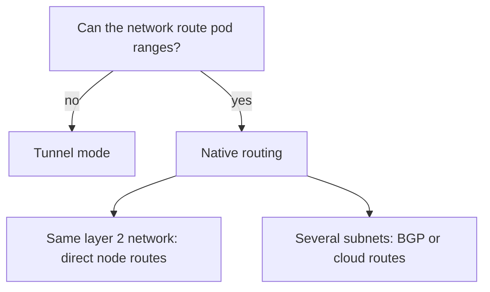

# Choosing A Datapath Model

Both models carry the same pod traffic, and both enforce the same policy. They differ in what they ask of the network and what they cost per packet. This part compares them on the points that matter in a decision and gives a short procedure to choose.

## The comparison

The two models differ in these ways.

- Packet size: an overlay adds a header, about 50 bytes for VXLAN. Native routing adds nothing.
- CPU cost: an overlay spends CPU on wrapping and unwrapping, although network cards can offload part of it. Native routing has no such step.
- Network requirements: an overlay needs only IP delivery between nodes and an open tunnel port. Native routing needs routes to all pod ranges.
- Visibility: in an overlay, network devices see only node-to-node UDP. With native routing they see the real pod addresses, so they can filter and monitor by pod address.
- Pod addresses outside the cluster: with native routing, pod addresses can be reachable from other networks, if the routes exist. With an overlay they cannot.



## A procedure to choose

Ask four questions in this order.

First, who owns the network, and can you change its routes? If you cannot, choose the overlay. Second, do the nodes share one layer 2 network? If yes, native routing with direct node routes is the simplest option. Third, are the nodes in different subnets and do you control the routers, or are you on a cloud with a route table integration? Then native routing with BGP or cloud routes is possible. Fourth, do other systems need to reach pods by their addresses without translation? That requires native routing.

When no answer favours native routing, the overlay is the safe default.

## How the model is stored

The model is not a property of a node but of the whole cluster, and it lives in `cilium-config`. The keys are `routing-mode`, `tunnel-protocol` for tunnel mode and `ipv4-native-routing-cidr` with `auto-direct-node-routes` for native routing. All agents must agree. Changing the model of a running cluster is a disruptive change that needs a planned restart of all agents.

## Try it

Read the model of the playground cluster.

<!-- astrona:playground:renew -->

Print the main keys in one command.

```sh
kubectl -n kube-system get configmap cilium-config -o yaml | grep -E 'routing-mode|tunnel|native-routing|auto-direct'
```

The output lists the keys that exist. Keys that Cilium leaves at their default may not appear. Check the nodes and their pod ranges next.

```sh
kubectl get nodes -o wide
kubectl get ciliumnodes -o custom-columns=NAME:.metadata.name,PODCIDRS:.spec.ipam.podCIDRs
```

Decide for yourself which answer of the procedure above applies to this cluster. Last, confirm that traffic crosses the nodes with the settings found.

```sh
kubectl -n starfleet get pods -o wide
kubectl -n starfleet exec shuttle -- curl -s -m 5 -o /dev/null -w '%{http_code}\n' http://probe.starfleet:9898/healthz
```

## Mixed requirements

Some clusters need both properties: real pod addresses for some traffic and no network changes for the rest. Cilium offers secondary options for such cases, for example routing a part of the traffic natively. These options add complexity and depend on the release, so read the reference of your release before you rely on them.

## What to remember

An overlay costs bytes and CPU and asks little of the network. Native routing costs nothing per packet and asks for routes to all pod ranges. Choose by what the network can provide: if you cannot change the network, use an overlay, and if you can, native routing is faster and more visible. The model is a cluster-wide setting in `cilium-config`, and changing it needs a planned restart.

## Effects on troubleshooting

The model changes where you look when something fails. In tunnel mode, a cross-node failure points to the tunnel port, the MTU or the ipcache. In native routing mode, it points to the node route table, the covering range or the routers. Hubble flows help in both models, because they are created inside the node before any wrapping.

## Effects on policy

Policy works the same way in both models. The agent resolves identities and applies rules at the interface. In tunnel mode, the identity can travel in the tunnel header. In native routing mode, the receiving node maps the source address to an identity through the ipcache. If that mapping is missing, for example for traffic from outside the cluster, the traffic carries a reserved identity, and policy treats it as such.

## Effects on upgrades

A change of the model touches every node. The agents must restart with the new settings, and the routes or tunnels change under running traffic. Plan this as a maintenance window and not as a rolling change during business hours. For clusters that must not stop, build a new cluster with the desired model and move workloads instead.

## Effects on cost

An overlay needs no coordination with the network team, and it saves their time. Native routing saves CPU and bandwidth on every node, which matters at high traffic volumes. For small clusters the difference is rarely visible, and the simpler operation decides.

## Common pitfalls

> [!WARNING]
> Do not choose native routing only for speed without checking who owns the routes. A cluster that needs a change in a network that you do not control will stop working when that team does not make it.
